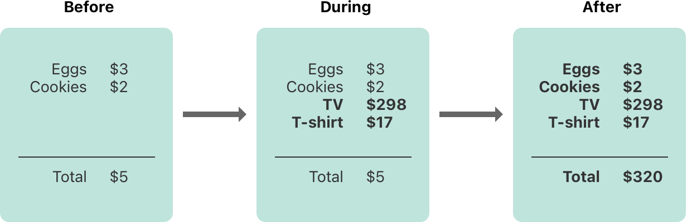
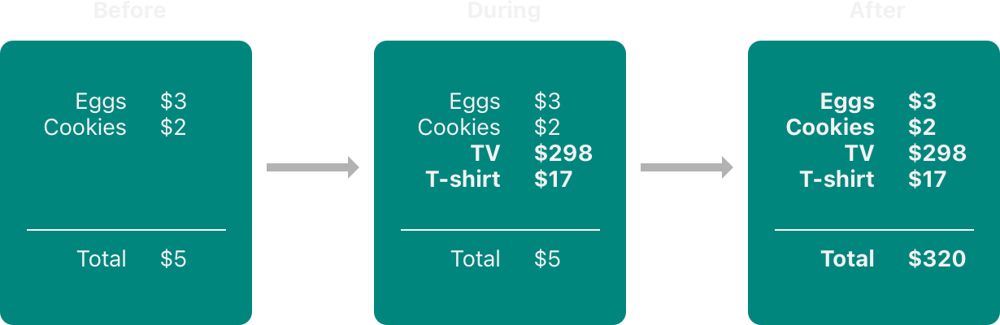
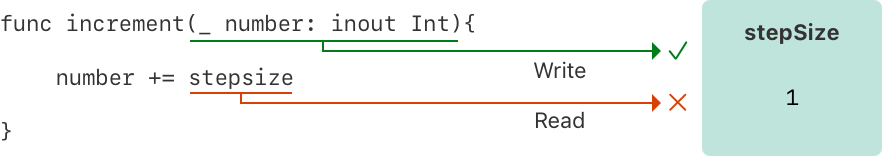
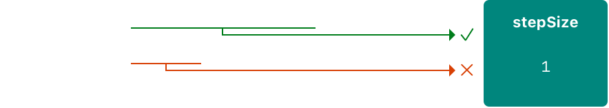
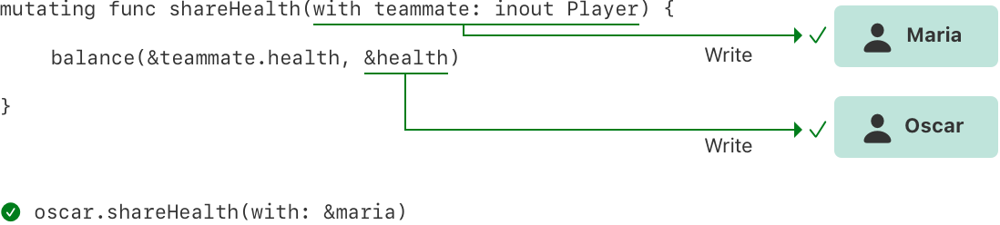
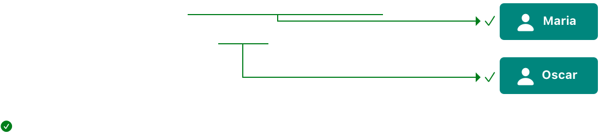
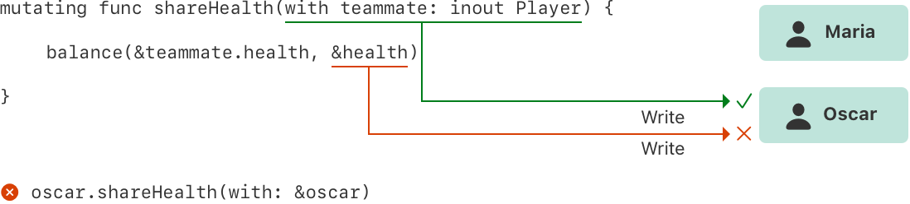
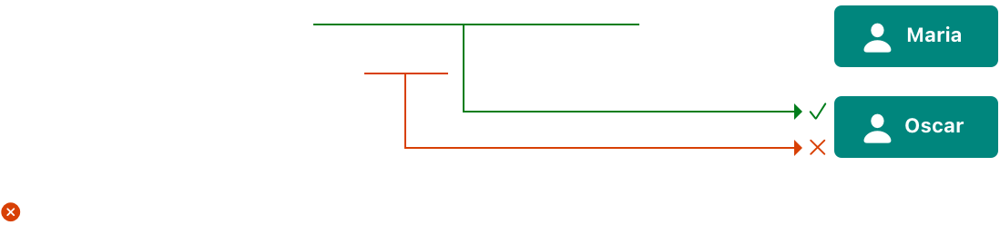

# 内存安全 {#Memory-Safety}

组织代码，避免在访问内存时发生冲突。

默认情况下，Swift 会防止你的代码中出现不安全的行为。例如，Swift 确保变量在使用之前已经初始化，确保内存被释放之后不会被访问，并检查数组下标是否越界。

Swift 还通过要求修改内存中某个位置的代码对该内存拥有独占访问，来确保对同一块内存的多次访问不会冲突。由于 Swift 自动管理内存，大多数时候你完全不需要考虑访问内存的问题。不过，了解潜在冲突可能出现在哪里很重要，这样你就能避免写出存在内存访问冲突的代码。如果你的代码确实存在冲突，就会在编译时或运行时收到错误。

## 理解内存访问冲突 {#Understanding-Conflicting-Access-to-Memory}

当你在代码中设置变量的值，或向函数传递实参时，就会发生内存访问。例如，下面的代码中同时包含一次读取访问和一次写入访问：

```swift
// A write access to the memory where one is stored.
var one = 1

// A read access from the memory where one is stored.
print("We're number \(one)!")
```

当代码的不同部分试图同时访问内存中的同一个位置时，就可能发生内存访问冲突。同时对一个内存位置进行多次访问，可能产生不可预测或不一致的行为。在 Swift 中，有些修改值的方式会跨越好几行代码，这就使得在某个值自身的修改过程中访问该值成为可能。

想想你如何更新一份写在纸上的预算，就能看到类似的问题。更新预算分两步：首先添加商品的名称和价格，然后修改总金额，以反映清单上当前的各项。在更新之前和更新之后，你都可以从预算中读取任何信息并得到正确的结果，如下图所示。



在你向预算中添加商品的过程中，预算处于一种临时的无效状态，因为总金额还没有更新以反映新添加的商品。在添加商品的过程中读取总金额，得到的信息是不正确的。

这个例子还展示了修复内存访问冲突时可能遇到的一个难题：有时修复冲突有多种方式，会产生不同的结果，而哪个结果正确并不总是显而易见。在这个例子中，取决于你想要原来的总金额还是更新后的总金额，$5 或 $320 都可能是正确答案。在修复访问冲突之前，你必须先确定这段代码原本想做什么。

> 注意：如果你写过并发或多线程代码，内存访问冲突可能是你很熟悉的问题。不过，这里讨论的访问冲突可能发生在单个线程上，并且*不*涉及并发或多线程代码。
>
> 如果你在单个线程内出现内存访问冲突，Swift 保证你会在编译时或运行时收到错误。对于多线程代码，可以使用 [Thread Sanitizer](https://developer.apple.com/documentation/xcode/diagnosing_memory_thread_and_crash_issues_early) 来帮助检测跨线程的访问冲突。

### 内存访问的特征 {#Characteristics-of-Memory-Access}

就访问冲突而言，需要考虑内存访问的三个特征：访问是读取还是写入、访问的持续时间，以及被访问的内存位置。具体来说，如果你有两次访问同时满足以下所有条件，就会发生冲突：

- 这两次访问不都是读取，也不都是原子访问。
- 它们访问内存中的同一个位置。
- 它们的持续时间有重叠。

读取访问和写入访问的区别通常很明显：写入访问会改变内存中的位置，而读取访问不会。内存位置指的是被访问的对象——例如某个变量、常量或属性。内存访问的持续时间要么是瞬时的，要么是长期的。

如果一次访问是对 [`Atomic`] 或 [`AtomicLazyReference`] 上某个原子操作的调用，或者只使用 C 的原子操作，那么它就是*原子*的；否则就是非原子的。C 原子函数的列表参见 `stdatomic(3)` 手册页。

[`Atomic`]: https://developer.apple.com/documentation/synchronization/atomic [`AtomicLazyReference`]: https://developer.apple.com/documentation/synchronization/atomiclazyreference

如果一次访问开始之后、结束之前不可能运行其他代码，那么这次访问就是*瞬时*的。从本质上说，两次瞬时访问不可能同时发生。大多数内存访问都是瞬时的。例如，下面代码清单中的所有读取访问和写入访问都是瞬时的：

```swift
func oneMore(than number: Int) -> Int {
    return number + 1
}

var myNumber = 1
myNumber = oneMore(than: myNumber)
print(myNumber)
// Prints "2".
```

不过，有几种访问内存的方式会跨越其他代码的执行，称为*长期*访问。瞬时访问和长期访问的区别在于，长期访问开始之后、结束之前可能运行其他代码，这种情况称为*重叠*。长期访问可以与其他长期访问和瞬时访问重叠。

重叠访问主要出现在以下代码中：在函数和方法中使用输入输出参数，或者使用结构体的可变方法。使用长期访问的具体 Swift 代码种类将在下面几节中讨论。

## 输入输出参数的访问冲突 {#Conflicting-Access-to-In-Out-Parameters}

函数对其所有输入输出参数都拥有长期写入访问。输入输出参数的写入访问在所有非输入输出参数求值完毕之后开始，并持续整个函数调用的过程。如果有多个输入输出参数，各写入访问的起始顺序与参数出现的顺序相同。

这种长期写入访问的一个后果是，你不能访问作为输入输出参数传入的那个原始变量，即使作用域规则和访问控制本来允许这样做——对原始变量的任何访问都会造成冲突。例如：

```swift
var stepSize = 1

func increment(_ number: inout Int) {
    number += stepSize
}

increment(&stepSize)
// Error: Conflicting accesses to stepSize.
```

在上面的代码中，`stepSize` 是一个全局变量，通常可以从 `increment(_:)` 内部访问。然而，对 `stepSize` 的读取访问与对 `number` 的写入访问重叠了。如下图所示，`number` 和 `stepSize` 都指向内存中的同一个位置。读取访问和写入访问指向同一块内存，并且相互重叠，因此产生了冲突。



解决这个冲突的一种方法是显式复制一份 `stepSize`：

```swift
// Make an explicit copy.
var copyOfStepSize = stepSize
increment(&copyOfStepSize)

// Update the original.
stepSize = copyOfStepSize
// stepSize is now 2
```

如果你在调用 `increment(_:)` 之前复制一份 `stepSize`，那么显然 `copyOfStepSize` 的值会按当前的步长递增。读取访问在写入访问开始之前就结束了，所以不存在冲突。

输入输出参数的长期写入访问还有一个后果：把同一个变量作为实参传给同一函数的多个输入输出参数，会产生冲突。例如：

```swift
func balance(_ x: inout Int, _ y: inout Int) {
    let sum = x + y
    x = sum / 2
    y = sum - x
}
var playerOneScore = 42
var playerTwoScore = 30
balance(&playerOneScore, &playerTwoScore)  // OK
balance(&playerOneScore, &playerOneScore)
// Error: Conflicting accesses to playerOneScore.
```

上面的 `balance(_:_:)` 函数通过修改它的两个参数，把总值平均分配给两者。用 `playerOneScore` 和 `playerTwoScore` 作为实参调用它不会产生冲突——虽然有两个在时间上重叠的写入访问，但它们访问的是内存中不同的位置。相比之下，把 `playerOneScore` 作为两个参数的值传入就会产生冲突，因为它试图同时向内存中的同一个位置执行两次写入访问。

> 注意：因为运算符也是函数，所以它们也可能对其输入输出参数有长期访问。例如，如果 `balance(_:_:)` 是一个名为 `<^>` 的运算符函数，那么写 `playerOneScore <^> playerOneScore` 会导致与 `balance(&playerOneScore, &playerOneScore)` 相同的冲突。

## 方法中对 self 的访问冲突 {#Conflicting-Access-to-self-in-Methods}

结构体上的可变方法在方法调用期间对 `self` 拥有写入访问。例如，设想一个游戏，每个玩家都有生命值，受到伤害时会减少，还有能量值，使用特殊能力时会减少。

```swift
struct Player {
    var name: String
    var health: Int
    var energy: Int

    static let maxHealth = 10
    mutating func restoreHealth() {
        health = Player.maxHealth
    }
}
```

在上面的 `restoreHealth()` 方法中，对 `self` 的写入访问从方法开头开始，一直持续到方法返回。在这种情况下，`restoreHealth()` 内部没有其他代码可能以重叠的方式访问 `Player` 实例的属性。下面的 `shareHealth(with:)` 方法接受另一个 `Player` 实例作为输入输出参数，从而产生了重叠访问的可能。

```swift
extension Player {
    mutating func shareHealth(with teammate: inout Player) {
        balance(&teammate.health, &health)
    }
}

var oscar = Player(name: "Oscar", health: 10, energy: 10)
var maria = Player(name: "Maria", health: 5, energy: 10)
oscar.shareHealth(with: &maria)  // OK
```

在上面的例子中，对 Oscar 的玩家调用 `shareHealth(with:)` 方法，让它与 Maria 的玩家共享生命值，不会造成冲突。方法调用期间存在对 `oscar` 的写入访问，因为 `oscar` 是可变方法中 `self` 的值；同一段时间内也存在对 `maria` 的写入访问，因为 `maria` 是作为输入输出参数传入的。如下图所示，它们访问的是内存中不同的位置。尽管这两个写入访问在时间上重叠，它们并不冲突。



然而，如果你把 `oscar` 作为实参传给 `shareHealth(with:)`，就会发生冲突：

```swift
oscar.shareHealth(with: &oscar)
// Error: Conflicting accesses to oscar.
```

可变方法在方法执行期间需要对 `self` 的写入访问，输入输出参数在同一段时间内也需要对 `teammate` 的写入访问。在该方法内部，`self` 和 `teammate` 都指向内存中的同一个位置——如下图所示。这两个写入访问指向同一块内存，并且相互重叠，因此产生了冲突。



## 属性的访问冲突 {#Conflicting-Access-to-Properties}

结构体、元组和枚举这类类型由各个独立的组成值构成，例如结构体的属性或元组的元素。因为这些是值类型，所以修改值中的任何一部分都会修改整个值，这意味着对其中一个属性的读取或写入访问需要对整个值的读取或写入访问。例如，对元组各元素的重叠写入访问会产生冲突：

```swift
var playerInformation = (health: 10, energy: 20)
balance(&playerInformation.health, &playerInformation.energy)
// Error: Conflicting access to properties of playerInformation.
```

在上面的例子中，对元组的元素调用 `balance(_:_:)` 会产生冲突，因为存在对 `playerInformation` 的重叠写入访问。`playerInformation.health` 和 `playerInformation.energy` 都作为输入输出参数传入，这意味着 `balance(_:_:)` 在函数调用期间需要对它们的写入访问。在这两种情况下，对元组元素的写入访问都需要对整个元组的写入访问。这意味着存在两个对 `playerInformation` 的写入访问，且它们的持续时间重叠，从而造成冲突。

下面的代码表明，对全局变量中存储的结构体的属性进行重叠写入访问，也会出现同样的错误。

```swift
var holly = Player(name: "Holly", health: 10, energy: 10)
balance(&holly.health, &holly.energy)  // Error
```

在实践中，对结构体属性的大多数访问都可以安全地重叠。例如，如果把上面例子中的变量 `holly` 从全局变量改为局部变量，编译器就能证明对该结构体存储属性的重叠访问是安全的：

```swift
func someFunction() {
    var oscar = Player(name: "Oscar", health: 10, energy: 10)
    balance(&oscar.health, &oscar.energy)  // OK
}
```

在上面的例子中，Oscar 的生命值和能量值作为两个输入输出参数传给 `balance(_:_:)`。编译器可以证明内存安全得以保持，因为这两个存储属性不会以任何方式相互影响。

限制对结构体属性的重叠访问，并不总是保持内存安全所必需的。内存安全是想要达成的保证，但独占访问是比内存安全更严格的要求——这意味着有些代码虽然违反了内存的独占访问，却仍然保持了内存安全。如果编译器能证明这种非独占的内存访问仍然安全，Swift 就允许这种内存安全代码。具体来说，如果满足以下条件，编译器就能证明对结构体属性的重叠访问是安全的：

- 你只访问实例的存储属性，而不访问计算属性或类属性。
- 该结构体是局部变量的值，而不是全局变量的值。
- 该结构体要么没有被任何闭包捕获，要么只被非逃逸闭包捕获。

如果编译器无法证明该访问是安全的，就不允许这种访问。
