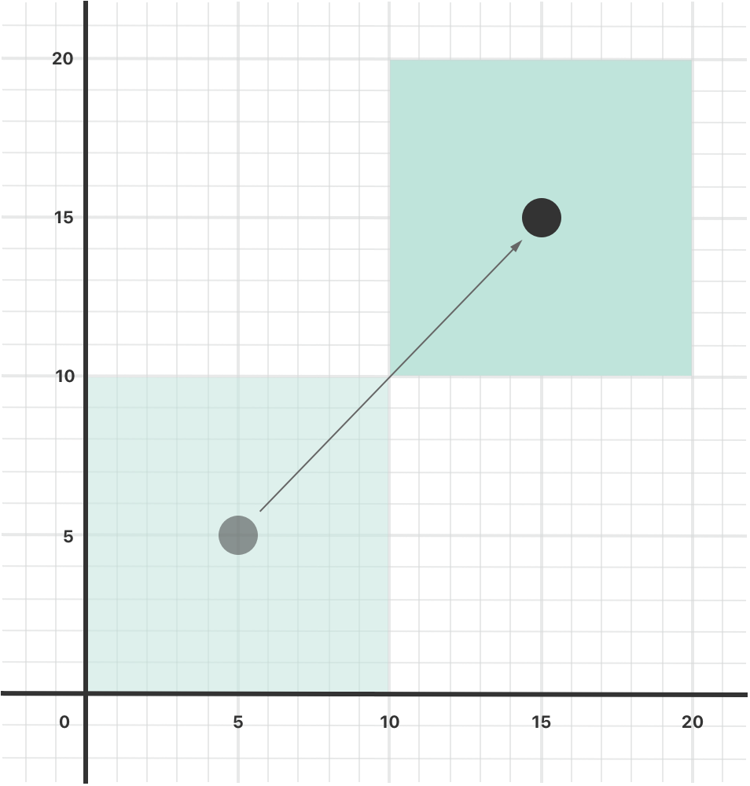
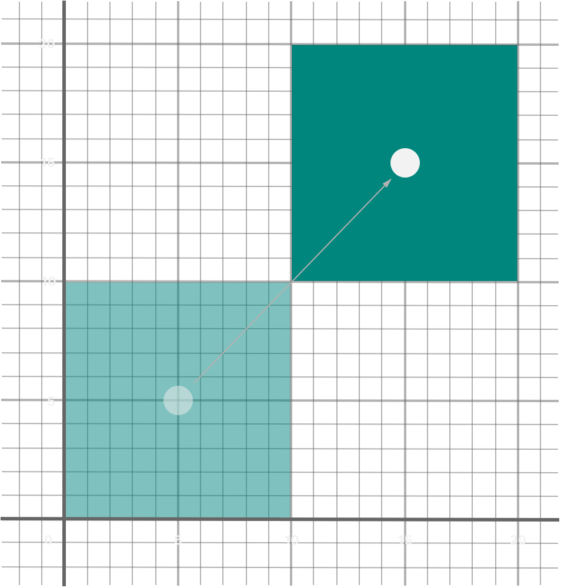
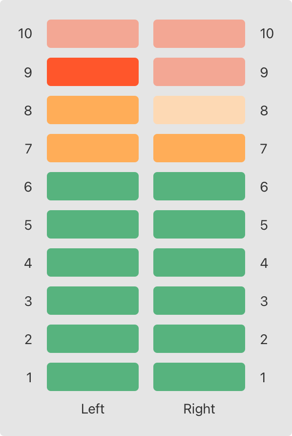
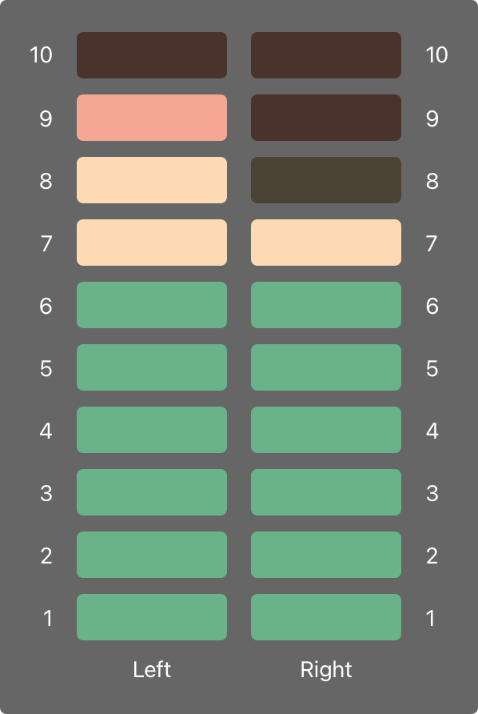

# 属性 {#Properties}

访问属于某个实例或类型的存储值和计算值。

*属性*（property）把值与特定的类、结构体或枚举关联起来。存储属性把常量和变量值作为实例的一部分存储起来，而计算属性则计算（而不是存储）一个值。计算属性由类、结构体和枚举提供，存储属性则只由类和结构体提供。

存储属性和计算属性通常与特定类型的实例相关联。不过，属性也可以与类型本身相关联。这类属性称为*类型属性*（type property）。

此外，你还可以定义*属性观察器*（property observer）来监视属性值的变化，并以自定义操作对此做出响应。属性观察器既可以添加到你自己定义的存储属性上，也可以添加到子类从父类继承的属性上。

你还可以使用*属性包装器*（property wrapper）来复用多个属性的 getter 和 setter 中的代码。

## 存储属性 {#Stored-Properties}

最简形式的存储属性，就是作为特定类或结构体实例的一部分存储起来的常量或变量。存储属性可以是*变量存储属性*（由 `var` 关键字引入），也可以是*常量存储属性*（由 `let` 关键字引入）。

你可以像 [默认属性值](initialization.md#Default-Property-Values) 中描述的那样，在定义存储属性时为其提供默认值。你也可以在构造过程中设置和修改存储属性的初始值。即使是常量存储属性也可以这样做，详见 [在构造过程中给常量属性赋值](initialization.md#Assigning-Constant-Properties-During-Initialization)。

下面的例子定义了一个名为 `FixedLengthRange` 的结构体，它描述一个整数区间，该区间的长度在创建后无法更改：

```swift
struct FixedLengthRange {
    var firstValue: Int
    let length: Int
}
var rangeOfThreeItems = FixedLengthRange(firstValue: 0, length: 3)
// the range represents integer values 0, 1, and 2
rangeOfThreeItems.firstValue = 6
// the range now represents integer values 6, 7, and 8
```

`FixedLengthRange` 的实例有一个名为 `firstValue` 的变量存储属性和一个名为 `length` 的常量存储属性。在上面的例子中，`length` 在创建新区间时完成初始化，此后就不能再更改，因为它是一个常量属性。

### 常量结构体实例的存储属性 {#Stored-Properties-of-Constant-Structure-Instances}

如果你创建了结构体的实例并把该实例赋给一个常量，就不能修改该实例的属性，即使这些属性被声明为变量属性：

```swift
let rangeOfFourItems = FixedLengthRange(firstValue: 0, length: 4)
// this range represents integer values 0, 1, 2, and 3
rangeOfFourItems.firstValue = 6
// this will report an error, even though firstValue is a variable property
```

因为 `rangeOfFourItems` 是用 `let` 关键字声明为常量的，所以无法更改它的 `firstValue` 属性，即使 `firstValue` 是一个变量属性。

这种行为源于结构体是*值类型*。当一个值类型的实例被标记为常量时，它的所有属性也同样成为常量。

类则不同，类是*引用类型*。如果你把引用类型的实例赋给一个常量，仍然可以更改该实例的变量属性。

### 延迟存储属性 {#Lazy-Stored-Properties}

*延迟存储属性*（lazy stored property）是指初始值在第一次被使用之前不会计算的属性。在声明前写 `lazy` 修饰符即可表示延迟存储属性。

> 注意：你必须始终把延迟属性声明为变量（使用 `var` 关键字），因为它的初始值可能要到实例构造完成后才会被获取。常量属性必须在构造完成*之前*就有一个值，因此不能声明为延迟属性。

当属性的初始值依赖于外部因素，而这些因素的值要到实例构造完成后才能确定时，延迟属性就很有用。当属性的初始值需要复杂或计算开销很大的设置，并且除非确实需要否则不应执行这些设置时，延迟属性也很有用。

下面的例子使用延迟存储属性来避免对复杂类进行不必要的构造。这个例子定义了两个类 `DataImporter` 和 `DataManager`，两者都没有完整展示：

```swift
class DataImporter {
    /*
    DataImporter is a class to import data from an external file.
    The class is assumed to take a nontrivial amount of time to initialize.
    */
    var filename = "data.txt"
    // the DataImporter class would provide data importing functionality here
}

class DataManager {
    lazy var importer = DataImporter()
    var data: [String] = []
    // the DataManager class would provide data management functionality here
}

let manager = DataManager()
manager.data.append("Some data")
manager.data.append("Some more data")
// the DataImporter instance for the importer property hasn't yet been created
```

`DataManager` 类有一个名为 `data` 的存储属性，它用一个新建的空 `String` 值数组来初始化。虽然其余功能没有展示，但这个 `DataManager` 类的用途是管理这个 `String` 数据数组并提供对它的访问。

`DataManager` 类的部分功能是能够从文件中导入数据。这一功能由 `DataImporter` 类提供，我们假定它的构造需要相当长的时间。这可能是因为 `DataImporter` 实例在构造时需要打开文件并把内容读入内存。

由于 `DataManager` 实例完全可能在不从文件导入任何数据的情况下管理其数据，因此 `DataManager` 在自身被创建时不会创建新的 `DataImporter` 实例。相反，更合理的做法是在第一次用到 `DataImporter` 实例时才创建它。

由于 `importer` 属性标记了 `lazy` 修饰符，它对应的 `DataImporter` 实例只在第一次访问 `importer` 属性时才会创建，例如查询它的 `filename` 属性时：

```swift
print(manager.importer.filename)
// the DataImporter instance for the importer property has now been created
// Prints "data.txt".
```

> 注意：如果多个线程同时访问一个标记了 `lazy` 修饰符且尚未初始化的属性，不能保证该属性只被初始化一次。

### 存储属性与实例变量 {#Stored-Properties-and-Instance-Variables}

如果你有 Objective-C 的经验，可能知道它提供*两种*方式把值和引用存储为类实例的一部分。除了属性之外，你还可以使用实例变量作为属性中所存值的底层存储。

Swift 把这些概念统一为单一的属性声明。Swift 属性没有对应的实例变量，属性的底层存储也不会被直接访问。这种做法避免了在不同上下文中访问值时产生的混淆，并把属性的声明简化为一条明确、统一的语句。关于属性的所有信息——包括名称、类型和内存管理特性——都作为类型定义的一部分集中定义在一个地方。

## 计算属性 {#Computed-Properties}

除了存储属性，类、结构体和枚举还可以定义*计算属性*（computed property）。计算属性并不实际存储值，而是提供一个 getter 和一个可选的 setter，以间接地获取和设置其他属性和值。

```swift
struct Point {
    var x = 0.0, y = 0.0
}
struct Size {
    var width = 0.0, height = 0.0
}
struct Rect {
    var origin = Point()
    var size = Size()
    var center: Point {
        get {
            let centerX = origin.x + (size.width / 2)
            let centerY = origin.y + (size.height / 2)
            return Point(x: centerX, y: centerY)
        }
        set(newCenter) {
            origin.x = newCenter.x - (size.width / 2)
            origin.y = newCenter.y - (size.height / 2)
        }
    }
}
var square = Rect(origin: Point(x: 0.0, y: 0.0),
    size: Size(width: 10.0, height: 10.0))
let initialSquareCenter = square.center
// initialSquareCenter is at (5.0, 5.0)
square.center = Point(x: 15.0, y: 15.0)
print("square.origin is now at (\(square.origin.x), \(square.origin.y))")
// Prints "square.origin is now at (10.0, 10.0)".
```

这个例子定义了三个用于处理几何图形的结构体：

- `Point` 封装了一个点的 x 坐标和 y 坐标。
- `Size` 封装了一个 `width` 和一个 `height`。
- `Rect` 用一个原点和一个尺寸定义了一个矩形。

`Rect` 结构体还提供了一个名为 `center` 的计算属性。`Rect` 当前的中心位置总可以由它的 `origin` 和 `size` 确定，因此不需要把中心点存储为一个显式的 `Point` 值。`Rect` 为一个名为 `center` 的计算变量定义了自定义的 getter 和 setter，让你可以像操作真正的存储属性一样操作矩形的 `center`。

上面的例子创建了一个名为 `square` 的新 `Rect` 变量。`square` 变量用原点 `(0, 0)` 以及宽和高均为 `10` 来初始化。这个正方形由下图中的浅绿色正方形表示。

然后通过点语法（`square.center`）访问 `square` 变量的 `center` 属性，这会调用 `center` 的 getter 来获取当前的属性值。getter 并不返回已有的值，而是实际计算并返回一个新的 `Point` 来表示正方形的中心。如上所示，getter 正确地返回了中心点 `(5, 5)`。

接着把 `center` 属性设置为新值 `(15, 15)`，这会把正方形向右上方移动，到达下图中深绿色正方形所示的新位置。设置 `center` 属性会调用 `center` 的 setter，它会修改存储属性 `origin` 的 `x` 和 `y` 值，并把正方形移动到新位置。



### 简写 setter 声明 {#Shorthand-Setter-Declaration}

如果计算属性的 setter 没有为新设置的值定义名称，就会使用默认名称 `newValue`。下面是 `Rect` 结构体的另一个版本，它利用了这一简写形式：

```swift
struct AlternativeRect {
    var origin = Point()
    var size = Size()
    var center: Point {
        get {
            let centerX = origin.x + (size.width / 2)
            let centerY = origin.y + (size.height / 2)
            return Point(x: centerX, y: centerY)
        }
        set {
            origin.x = newValue.x - (size.width / 2)
            origin.y = newValue.y - (size.height / 2)
        }
    }
}
```

### 简写 getter 声明 {#Shorthand-Getter-Declaration}

如果 getter 的整个主体只有一个表达式，getter 会隐式返回该表达式。下面是 `Rect` 结构体的又一个版本，它同时利用了这种简写形式和 setter 的简写形式：

```swift
struct CompactRect {
    var origin = Point()
    var size = Size()
    var center: Point {
        get {
            Point(x: origin.x + (size.width / 2),
                  y: origin.y + (size.height / 2))
        }
        set {
            origin.x = newValue.x - (size.width / 2)
            origin.y = newValue.y - (size.height / 2)
        }
    }
}
```

在 getter 中省略 `return` 与在函数中省略 `return` 遵循相同的规则，详见 [隐式返回的函数](functions.md#Functions-With-an-Implicit-Return)。

### 只读计算属性 {#Read-Only-Computed-Properties}

只有 getter 而没有 setter 的计算属性称为*只读计算属性*（read-only computed property）。只读计算属性总是返回一个值，可以通过点语法访问，但不能设置为不同的值。

> 注意：你必须把计算属性——包括只读计算属性——声明为使用 `var` 关键字的变量属性，因为它们的值不是固定的。`let` 关键字只用于常量属性，表示这些值在作为实例构造的一部分设置之后就不能再更改。

你可以去掉 `get` 关键字及其花括号，从而简化只读计算属性的声明：

```swift
struct Cuboid {
    var width = 0.0, height = 0.0, depth = 0.0
    var volume: Double {
        return width * height * depth
    }
}
let fourByFiveByTwo = Cuboid(width: 4.0, height: 5.0, depth: 2.0)
print("the volume of fourByFiveByTwo is \(fourByFiveByTwo.volume)")
// Prints "the volume of fourByFiveByTwo is 40.0".
```

这个例子定义了一个名为 `Cuboid` 的新结构体，它表示一个三维长方体，带有 `width`、`height` 和 `depth` 属性。这个结构体还有一个名为 `volume` 的只读计算属性，用于计算并返回长方体的当前体积。让 `volume` 可设置并不合理，因为对于一个特定的 `volume` 值，应该使用哪些 `width`、`height` 和 `depth` 值会产生歧义。尽管如此，`Cuboid` 提供只读计算属性仍然很有用，可以让外部使用者获知其当前计算出的体积。

## 属性观察器 {#Property-Observers}

属性观察器观察并响应属性值的变化。每次设置属性值时都会调用属性观察器，即使新值与属性当前值相同也是如此。

你可以在以下位置添加属性观察器：

- 你定义的存储属性
- 你继承的存储属性
- 你继承的计算属性

对于继承的属性，你可以通过在子类中重写该属性来添加属性观察器。对于你自己定义的计算属性，应使用该属性的 setter 来观察和响应值的变化，而不是试图创建观察器。重写属性详见 [重写](inheritance.md#Overriding)。

你可以选择在属性上定义下面两种观察器中的任意一种或两种：

- `willSet` 在值被存储之前调用。
- `didSet` 在新值被存储之后立即调用。

如果你实现了 `willSet` 观察器，新的属性值会作为常量形参传给它。你可以在 `willSet` 实现中为这个形参指定名称。如果实现中没有写形参名和圆括号，该形参将以默认形参名 `newValue` 提供。

同样，如果你实现了 `didSet` 观察器，它会收到一个包含旧属性值的常量形参。你可以为这个形参命名，也可以使用默认形参名 `oldValue`。如果你在属性自己的 `didSet` 观察器内给该属性赋值，你赋的新值会替换刚刚设置的值。

> 注意：当在子类构造器中设置属性时，父类属性的 `willSet` 和 `didSet` 观察器会在父类构造器被调用之后才被调用。在类的构造器主体中设置自身的属性时，不会调用这些观察器。
>
> 关于构造器代理的更多信息，请参阅 [值类型的构造器代理](initialization.md#Initializer-Delegation-for-Value-Types) 和 [类类型的构造器代理](initialization.md#Initializer-Delegation-for-Class-Types)。

下面是一个演示 `willSet` 和 `didSet` 实际用法的例子。这个例子定义了一个名为 `StepCounter` 的新类，用于记录一个人在行走时的总步数。这个类可以与来自计步器或其他步数计数器的输入数据配合使用，以跟踪一个人日常锻炼的情况。

```swift
class StepCounter {
    var totalSteps: Int = 0 {
        willSet(newTotalSteps) {
            print("About to set totalSteps to \(newTotalSteps)")
        }
        didSet {
            if totalSteps > oldValue  {
                print("Added \(totalSteps - oldValue) steps")
            }
        }
    }
}
let stepCounter = StepCounter()
stepCounter.totalSteps = 200
// About to set totalSteps to 200
// Added 200 steps
stepCounter.totalSteps = 360
// About to set totalSteps to 360
// Added 160 steps
stepCounter.totalSteps = 896
// About to set totalSteps to 896
// Added 536 steps
```

`StepCounter` 类声明了一个 `Int` 类型的 `totalSteps` 属性。这是一个带有 `willSet` 和 `didSet` 观察器的存储属性。

每当 `totalSteps` 被赋予新值时，都会调用它的 `willSet` 和 `didSet` 观察器，即使新值与当前值相同也是如此。

这个例子中的 `willSet` 观察器使用自定义形参名 `newTotalSteps` 来表示即将到来的新值。在这个例子中，它只是打印出即将设置的值。

`didSet` 观察器在 `totalSteps` 的值更新之后调用。它把 `totalSteps` 的新值与旧值进行比较。如果总步数增加了，就打印一条消息，说明新增了多少步。这个 `didSet` 观察器没有为旧值提供自定义形参名，而是使用默认名称 `oldValue`。

> 注意：如果你把一个带有观察器的属性作为输入输出参数传给函数，`willSet` 和 `didSet` 观察器总会被调用。这是因为输入输出参数采用“拷入拷出”（copy-in copy-out）内存模型：函数结束时，值总会被写回属性。关于输入输出参数行为的详细讨论，请参阅 [输入输出参数](declarations.md#In-Out-Parameters)。

## 属性包装器 {#Property-Wrappers}

属性包装器在管理属性存储方式的代码与定义属性的代码之间增加了一层分离。例如，如果你有一些属性需要提供线程安全检查，或者需要把底层数据存储在数据库中，那么你必须在每个属性上都写这些代码。使用属性包装器时，你只需在定义包装器时编写一次管理代码，然后通过把包装器应用到多个属性上来复用这段管理代码。

要定义属性包装器，可以创建一个定义 `wrappedValue` 属性的结构体、枚举或类。在下面的代码中，`TwelveOrLess` 结构体确保它所包装的值始终是小于或等于 12 的数。如果你让它存储一个更大的数，它就会改为存储 12。

```swift
@propertyWrapper
struct TwelveOrLess {
    private var number = 0
    var wrappedValue: Int {
        get { return number }
        set { number = min(newValue, 12) }
    }
}
```

setter 确保新值小于或等于 12，getter 则返回存储的值。

> 注意：上面例子中 `number` 的声明把该变量标记为 `private`，这确保 `number` 只在 `TwelveOrLess` 的实现中使用。写在其他任何地方的代码都通过 `wrappedValue` 的 getter 和 setter 来访问该值，不能直接使用 `number`。关于 `private` 的信息，请参阅 [访问控制](access-control.md)。

要把包装器应用到属性上，可以把包装器的名称作为特性写在属性前面。下面这个结构体存储一个矩形，它使用 `TwelveOrLess` 属性包装器来确保矩形的尺寸始终不超过 12：

```swift
struct SmallRectangle {
    @TwelveOrLess var height: Int
    @TwelveOrLess var width: Int
}

var rectangle = SmallRectangle()
print(rectangle.height)
// Prints "0".

rectangle.height = 10
print(rectangle.height)
// Prints "10".

rectangle.height = 24
print(rectangle.height)
// Prints "12".
```

`height` 和 `width` 属性的初始值来自 `TwelveOrLess` 的定义，它把 `TwelveOrLess.number` 设为 0。`TwelveOrLess` 中的 setter 认为 10 是有效值，因此把 10 存入 `rectangle.height` 会按原样执行。然而，24 超出了 `TwelveOrLess` 允许的范围，所以试图存储 24 最终会把 `rectangle.height` 设为 12，即允许的最大值。

当你把包装器应用到属性上时，编译器会合成代码，为包装器提供存储，并合成通过包装器访问该属性的代码。（属性包装器负责存储被包装值，因此这部分没有合成的代码。）你也可以编写利用属性包装器行为的代码，而不使用特殊的特性语法。例如，下面是上一个代码清单中 `SmallRectangle` 的另一个版本，它显式地把属性包装在 `TwelveOrLess` 结构体中，而不是把 `@TwelveOrLess` 写成特性：

```swift
struct SmallRectangle {
    private var _height = TwelveOrLess()
    private var _width = TwelveOrLess()
    var height: Int {
        get { return _height.wrappedValue }
        set { _height.wrappedValue = newValue }
    }
    var width: Int {
        get { return _width.wrappedValue }
        set { _width.wrappedValue = newValue }
    }
}
```

`_height` 和 `_width` 属性存储属性包装器 `TwelveOrLess` 的实例。`height` 和 `width` 的 getter 和 setter 封装了对 `wrappedValue` 属性的访问。

### 为被包装属性设置初始值 {#Setting-Initial-Values-for-Wrapped-Properties}

上面示例中的代码通过在 `TwelveOrLess` 的定义中为 `number` 指定初始值，来设置被包装属性的初始值。使用这个属性包装器的代码无法为被 `TwelveOrLess` 包装的属性指定不同的初始值——例如，`SmallRectangle` 的定义无法为 `height` 或 `width` 提供初始值。为了支持设置初始值或其他自定义设置，属性包装器需要添加构造器。下面是 `TwelveOrLess` 的扩展版本，名为 `SmallNumber`，它定义了用于设置被包装值和最大值的构造器：

```swift
@propertyWrapper
struct SmallNumber {
    private var maximum: Int
    private var number: Int

    var wrappedValue: Int {
        get { return number }
        set { number = min(newValue, maximum) }
    }

    init() {
        maximum = 12
        number = 0
    }
    init(wrappedValue: Int) {
        maximum = 12
        number = min(wrappedValue, maximum)
    }
    init(wrappedValue: Int, maximum: Int) {
        self.maximum = maximum
        number = min(wrappedValue, maximum)
    }
}
```

`SmallNumber` 的定义包含三个构造器——`init()`、`init(wrappedValue:)` 和 `init(wrappedValue:maximum:)`——下面的示例使用它们来设置被包装值和最大值。关于构造过程和构造器语法的信息，请参阅 [构造过程](initialization.md)。

当你把包装器应用到属性上并且没有指定初始值时，Swift 使用 `init()` 构造器来设置包装器。例如：

```swift
struct ZeroRectangle {
    @SmallNumber var height: Int
    @SmallNumber var width: Int
}

var zeroRectangle = ZeroRectangle()
print(zeroRectangle.height, zeroRectangle.width)
// Prints "0 0".
```

包装 `height` 和 `width` 的 `SmallNumber` 实例通过调用 `SmallNumber()` 创建。该构造器内部的代码使用默认值 0 和 12 来设置初始的被包装值和初始的最大值。属性包装器仍然提供所有初始值，就像前面在 `SmallRectangle` 中使用 `TwelveOrLess` 的例子一样。与那个例子不同的是，`SmallNumber` 还支持在声明属性时写出这些初始值。

当你为属性指定初始值时，Swift 使用 `init(wrappedValue:)` 构造器来设置包装器。例如：

```swift
struct UnitRectangle {
    @SmallNumber var height: Int = 1
    @SmallNumber var width: Int = 1
}

var unitRectangle = UnitRectangle()
print(unitRectangle.height, unitRectangle.width)
// Prints "1 1".
```

当你在带包装器的属性上写 `= 1` 时，这会转换为对 `init(wrappedValue:)` 构造器的调用。包装 `height` 和 `width` 的 `SmallNumber` 实例通过调用 `SmallNumber(wrappedValue: 1)` 创建。该构造器使用这里指定的被包装值，并使用默认的最大值 12。

当你在自定义特性后面的圆括号中写实参时，Swift 使用接受这些实参的构造器来设置包装器。例如，如果你同时提供初始值和最大值，Swift 会使用 `init(wrappedValue:maximum:)` 构造器：

```swift
struct NarrowRectangle {
    @SmallNumber(wrappedValue: 2, maximum: 5) var height: Int
    @SmallNumber(wrappedValue: 3, maximum: 4) var width: Int
}

var narrowRectangle = NarrowRectangle()
print(narrowRectangle.height, narrowRectangle.width)
// Prints "2 3".

narrowRectangle.height = 100
narrowRectangle.width = 100
print(narrowRectangle.height, narrowRectangle.width)
// Prints "5 4".
```

包装 `height` 的 `SmallNumber` 实例通过调用 `SmallNumber(wrappedValue: 2, maximum: 5)` 创建，包装 `width` 的实例通过调用 `SmallNumber(wrappedValue: 3, maximum: 4)` 创建。

通过在属性包装器中包含实参，你可以在包装器创建时设置其初始状态，或向它传递其他选项。这种语法是使用属性包装器最通用的方式。你可以向特性提供任何需要的实参，它们会被传递给构造器。

当你包含属性包装器实参时，也可以用赋值来指定初始值。Swift 会把该赋值当作 `wrappedValue` 实参，并使用接受你所包含实参的构造器。例如：

```swift
struct MixedRectangle {
    @SmallNumber var height: Int = 1
    @SmallNumber(maximum: 9) var width: Int = 2
}

var mixedRectangle = MixedRectangle()
print(mixedRectangle.height)
// Prints "1".

mixedRectangle.height = 20
print(mixedRectangle.height)
// Prints "12".
```

包装 `height` 的 `SmallNumber` 实例通过调用 `SmallNumber(wrappedValue: 1)` 创建，它使用默认的最大值 12。包装 `width` 的实例通过调用 `SmallNumber(wrappedValue: 2, maximum: 9)` 创建。

### 从属性包装器投射出一个值 {#Projecting-a-Value-From-a-Property-Wrapper}

除了被包装值之外，属性包装器还可以通过定义*投射值*（projected value）来暴露额外功能——例如，管理数据库访问的属性包装器可以在其投射值上暴露一个 `flushDatabaseConnection()` 方法。投射值的名称与被包装值相同，只是以美元符号（`$`）开头。由于你的代码无法定义以 `$` 开头的属性，投射值永远不会与你定义的属性冲突。

在上面的 `SmallNumber` 示例中，如果你试图把属性设置为一个过大的数，属性包装器会在存储之前调整这个数。下面的代码为 `SmallNumber` 结构体添加了一个 `projectedValue` 属性，用来记录属性包装器在存储新值之前是否调整了该属性的新值。

```swift
@propertyWrapper
struct SmallNumber {
    private var number: Int
    private(set) var projectedValue: Bool

    var wrappedValue: Int {
        get { return number }
        set {
            if newValue > 12 {
                number = 12
                projectedValue = true
            } else {
                number = newValue
                projectedValue = false
            }
        }
    }

    init() {
        self.number = 0
        self.projectedValue = false
    }
}
struct SomeStructure {
    @SmallNumber var someNumber: Int
}
var someStructure = SomeStructure()

someStructure.someNumber = 4
print(someStructure.$someNumber)
// Prints "false".

someStructure.someNumber = 55
print(someStructure.$someNumber)
// Prints "true".
```

写 `someStructure.$someNumber` 会访问包装器的投射值。在存储像 4 这样较小的数之后，`someStructure.$someNumber` 的值是 `false`。然而，在试图存储像 55 这样过大的数之后，投射值为 `true`。

属性包装器可以返回任何类型的值作为其投射值。在这个例子中，属性包装器只暴露一条信息——数字是否被调整过——因此它把那个布尔值作为投射值暴露出来。需要暴露更多信息的包装器可以返回其他类型的实例，也可以返回 `self`，把包装器实例作为投射值暴露出来。

当你从类型内部的代码（例如属性 getter 或实例方法）访问投射值时，可以像访问其他属性一样省略属性名前的 `self.`。下面示例中的代码把 `height` 和 `width` 周围包装器的投射值分别称为 `$height` 和 `$width`：

```swift
enum Size {
    case small, large
}

struct SizedRectangle {
    @SmallNumber var height: Int
    @SmallNumber var width: Int

    mutating func resize(to size: Size) -> Bool {
        switch size {
        case .small:
            height = 10
            width = 20
        case .large:
            height = 100
            width = 100
        }
        return $height || $width
    }
}
```

因为属性包装器语法只是带有 getter 和 setter 的属性的语法糖，所以访问 `height` 和 `width` 的行为与访问任何其他属性相同。例如，`resize(to:)` 中的代码通过它们的属性包装器访问 `height` 和 `width`。如果你调用 `resize(to: .large)`，`.large` 对应的 switch 分支会把矩形的 `height` 和 `width` 设为 100。包装器阻止这些属性的值大于 12，并把投射值设为 `true`，以记录它调整了这些值这一事实。在 `resize(to:)` 末尾，返回语句检查 `$height` 和 `$width`，以确定属性包装器是否调整了 `height` 或 `width`。

## 全局变量和局部变量 {#Global-and-Local-Variables}

上文介绍的用于计算和观察属性的能力同样适用于*全局变量*（global variable）和*局部变量*（local variable）。全局变量是在任何函数、方法、闭包或类型上下文之外定义的变量。局部变量是在函数、方法或闭包上下文中定义的变量。

你在前面各章见到的全局变量和局部变量都是*存储变量*。存储变量与存储属性一样，为某个类型的值提供存储，并允许设置和获取该值。

不过，你也可以在全局或局部作用域中定义*计算变量*，并为存储变量定义观察器。计算变量计算其值，而不是存储该值，它们的写法与计算属性相同。

> 注意：全局常量和变量总是延迟计算的，方式与 [延迟存储属性](properties.md#Lazy-Stored-Properties) 类似。与延迟存储属性不同，全局常量和变量无需标记 `lazy` 修饰符。
>
> 局部常量和变量从不延迟计算。

你可以把属性包装器应用到局部存储变量上，但不能应用到全局变量或计算变量上。例如，在下面的代码中，`myNumber` 使用 `SmallNumber` 作为属性包装器。

```swift
func someFunction() {
    @SmallNumber var myNumber: Int = 0

    myNumber = 10
    // now myNumber is 10

    myNumber = 24
    // now myNumber is 12
}
```

就像把 `SmallNumber` 应用到属性上时一样，把 `myNumber` 的值设为 10 是有效的。由于属性包装器不允许高于 12 的值，所以它把 `myNumber` 设为 12，而不是 24。

## 类型属性 {#Type-Properties}

实例属性是属于特定类型实例的属性。每当你创建该类型的新实例时，它都有自己的一组属性值，与任何其他实例相互独立。

你也可以定义属于类型本身而不属于该类型任何实例的属性。无论你创建多少个该类型的实例，这些属性都只有一份副本。这类属性称为*类型属性*（type property）。

类型属性适用于定义对特定类型的*所有*实例都通用的值，例如所有实例都可以使用的常量属性（类似 C 中的静态常量），或者存储对该类型所有实例都全局的值的变量属性（类似 C 中的静态变量）。

存储类型属性可以是变量或常量。计算类型属性始终声明为变量属性，与计算实例属性相同。

> 注意：与存储实例属性不同，你必须始终为存储类型属性提供默认值。这是因为类型本身没有构造器，无法在构造时为存储类型属性赋值。
>
> 存储类型属性在第一次访问时延迟初始化。它们保证只初始化一次，即使被多个线程同时访问也是如此，而且无需标记 `lazy` 修饰符。

### 类型属性语法 {#Type-Property-Syntax}

在 C 和 Objective-C 中，你把与某个类型关联的静态常量和变量定义为*全局*静态变量。然而在 Swift 中，类型属性写在类型定义内部、类型外层花括号内，而且每个类型属性都显式限定在它所支持的类型作用域内。

你使用 `static` 关键字定义类型属性。对于类类型中的计算类型属性，你可以改用 `class` 关键字，以允许子类重写父类的实现。下面的例子展示了存储类型属性和计算类型属性的语法：

```swift
struct SomeStructure {
    static var storedTypeProperty = "Some value."
    static var computedTypeProperty: Int {
        return 1
    }
}
enum SomeEnumeration {
    static var storedTypeProperty = "Some value."
    static var computedTypeProperty: Int {
        return 6
    }
}
class SomeClass {
    static var storedTypeProperty = "Some value."
    static var computedTypeProperty: Int {
        return 27
    }
    class var overrideableComputedTypeProperty: Int {
        return 107
    }
}
```

> 注意：上面的计算类型属性示例都是只读计算类型属性，但你也可以用与计算实例属性相同的语法定义读写的计算类型属性。

### 查询和设置类型属性 {#Querying-and-Setting-Type-Properties}

类型属性像实例属性一样使用点语法来查询和设置。不过，类型属性是在*类型*上查询和设置的，而不是在该类型的实例上。例如：

```swift
print(SomeStructure.storedTypeProperty)
// Prints "Some value."
SomeStructure.storedTypeProperty = "Another value."
print(SomeStructure.storedTypeProperty)
// Prints "Another value."
print(SomeEnumeration.computedTypeProperty)
// Prints "6".
print(SomeClass.computedTypeProperty)
// Prints "27".
```

接下来的示例使用两个存储类型属性，它们属于一个为若干音频通道建模音频电平表的结构体。每个通道都有一个介于 `0` 和 `10` 之间（含两端）的整数音频电平。

下图演示了如何把其中两个音频通道组合起来，为立体声音频电平表建模。当某个通道的音频电平为 `0` 时，该通道的所有灯都不亮。当音频电平为 `10` 时，该通道的所有灯都亮。在下图中，左通道的当前电平为 `9`，右通道的当前电平为 `7`：



上面描述的音频通道由 `AudioChannel` 结构体的实例表示：

```swift
struct AudioChannel {
    static let thresholdLevel = 10
    static var maxInputLevelForAllChannels = 0
    var currentLevel: Int = 0 {
        didSet {
            if currentLevel > AudioChannel.thresholdLevel {
                // cap the new audio level to the threshold level
                currentLevel = AudioChannel.thresholdLevel
            }
            if currentLevel > AudioChannel.maxInputLevelForAllChannels {
                // store this as the new overall maximum input level
                AudioChannel.maxInputLevelForAllChannels = currentLevel
            }
        }
    }
}
```

`AudioChannel` 结构体定义了两个存储类型属性来支持其功能。第一个是 `thresholdLevel`，它定义了音频电平可以取的最大阈值。对所有 `AudioChannel` 实例来说，这都是常量值 `10`。如果输入的音频信号值高于 `10`，就会被限制到这个阈值（如下所述）。

第二个类型属性是一个名为 `maxInputLevelForAllChannels` 的变量存储类型属性。它记录*任何* `AudioChannel` 实例已接收到的最大输入值。它的初始值为 `0`。

`AudioChannel` 结构体还定义了一个名为 `currentLevel` 的存储实例属性，它表示通道当前在 `0` 到 `10` 范围内的音频电平。

`currentLevel` 属性有一个 `didSet` 属性观察器，用于在每次设置 `currentLevel` 时检查其值。这个观察器执行两项检查：

- 如果 `currentLevel` 的新值大于允许的 `thresholdLevel`，属性观察器会把 `currentLevel` 限制为 `thresholdLevel`。
- 如果 `currentLevel` 的新值（在限制之后）高于*任何* `AudioChannel` 实例此前接收到的任何值，属性观察器会把新的 `currentLevel` 值存入 `maxInputLevelForAllChannels` 类型属性。

> 注意：在这两项检查的第一项中，`didSet` 观察器把 `currentLevel` 设为另一个值。然而，这不会导致该观察器再次被调用。

你可以使用 `AudioChannel` 结构体创建两个新的音频通道 `leftChannel` 和 `rightChannel`，表示立体声音响系统的音频电平：

```swift
var leftChannel = AudioChannel()
var rightChannel = AudioChannel()
```

如果你把*左*通道的 `currentLevel` 设为 `7`，可以看到 `maxInputLevelForAllChannels` 类型属性会更新为 `7`：

```swift
leftChannel.currentLevel = 7
print(leftChannel.currentLevel)
// Prints "7".
print(AudioChannel.maxInputLevelForAllChannels)
// Prints "7".
```

如果你试图把*右*通道的 `currentLevel` 设为 `11`，可以看到右通道的 `currentLevel` 属性会被限制到最大值 `10`，并且 `maxInputLevelForAllChannels` 类型属性会更新为 `10`：

```swift
rightChannel.currentLevel = 11
print(rightChannel.currentLevel)
// Prints "10".
print(AudioChannel.maxInputLevelForAllChannels)
// Prints "10".
```
