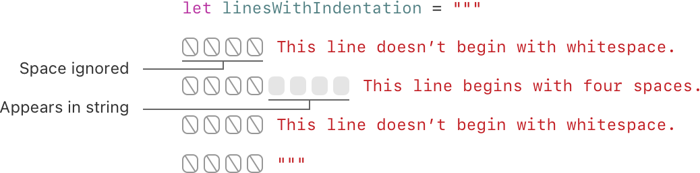
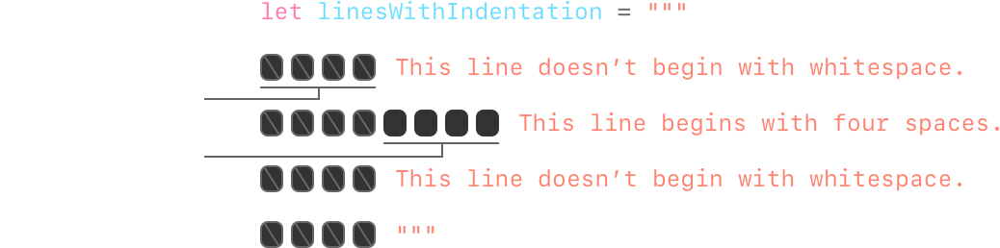
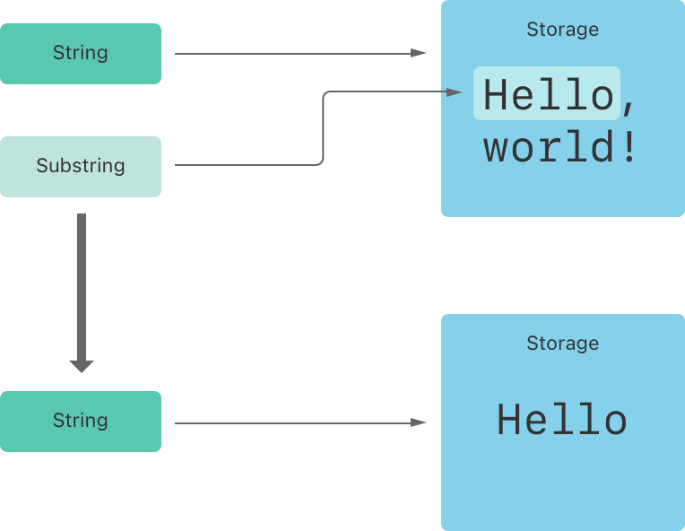
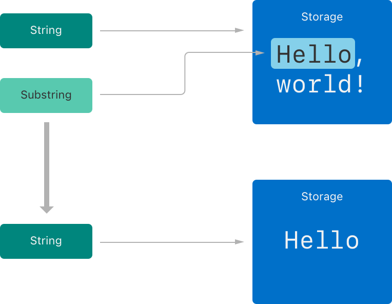
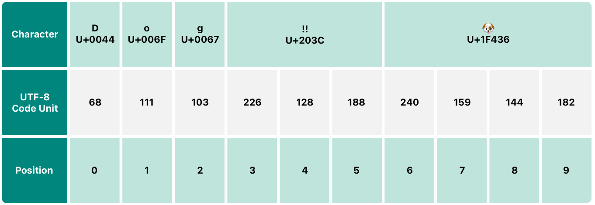
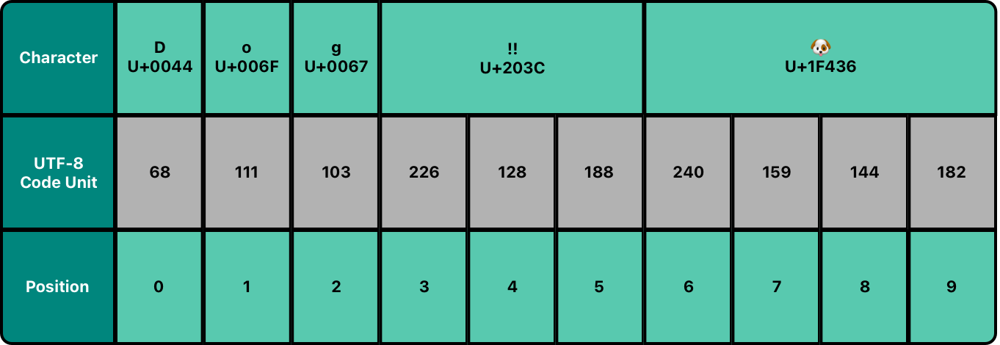
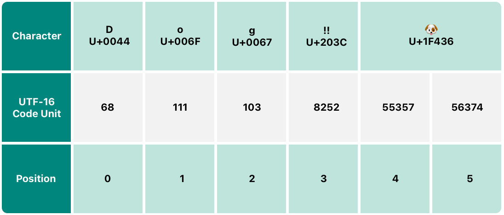
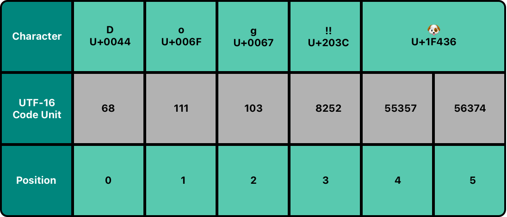
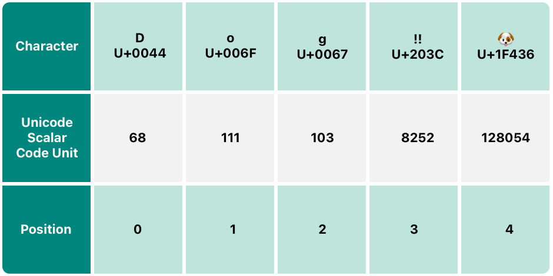
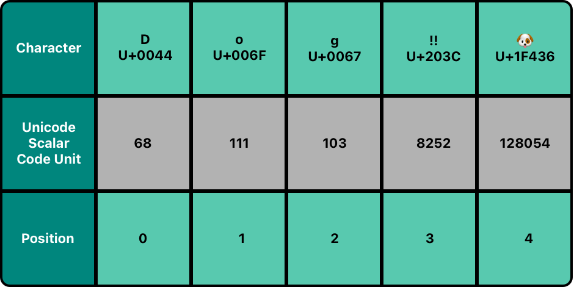

# 字符串和字符 {#Strings-and-Characters}

存储和操作文本。

*字符串*（string）是一系列字符，例如 `"hello, world"` 或 `"albatross"`。Swift 字符串由 `String` 类型表示。`String` 的内容可以通过多种方式访问，包括作为 `Character` 值的集合。

Swift 的 `String` 和 `Character` 类型提供了一种快速且符合 Unicode 的方式，让你在代码中处理文本。字符串的创建和操作语法轻量易读，字符串字面量语法与 C 类似。字符串拼接只需用 `+` 运算符连接两个字符串，而字符串的可变性则通过在常量或变量之间选择来管理，就像 Swift 中的其他值一样。你还可以利用字符串插值，把常量、变量、字面量和表达式插入较长的字符串。这使得为显示、存储和打印创建自定义字符串值变得容易。

尽管语法如此简单，Swift 的 `String` 类型仍是一种快速、现代的字符串实现。每个字符串都由与编码无关的 Unicode 字符组成，并支持以各种 Unicode 表示形式访问这些字符。

> 注意：Swift 的 `String` 类型与 Foundation 的 `NSString` 类桥接。Foundation 还扩展了 `String`，公开 `NSString` 定义的方法。这意味着，如果你导入了 Foundation，就可以直接在 `String` 上访问那些 `NSString` 方法，而无需转换。
>
> 关于在 Foundation 和 Cocoa 中使用 `String` 的更多信息，参见 [Bridging Between String and NSString](https://developer.apple.com/documentation/swift/string#Bridging-Between-String-and-NSString)。

## 字符串字面量 {#String-Literals}

你可以把预定义的 `String` 值作为*字符串字面量*（string literal）包含在代码中。字符串字面量是由双引号（`"`）包围的字符序列。

使用字符串字面量作为常量或变量的初始值：

```swift
let someString = "Some string literal value"
```

注意，Swift 会推断 `someString` 常量的类型为 `String`，因为它是用字符串字面量值初始化的。

### 多行字符串字面量 {#Multiline-String-Literals}

如果你需要跨多行的字符串，请使用多行字符串字面量——由三个双引号包围的字符序列：

```swift
let quotation = """
The White Rabbit put on his spectacles.  "Where shall I begin,
please your Majesty?" he asked.

"Begin at the beginning," the King said gravely, "and go on
till you come to the end; then stop."
"""
```

多行字符串字面量包含其起止引号之间的所有行。字符串从起始引号（`"""`）之后的第一行开始，到结束引号之前的行结束，这意味着下面两个字符串都不以换行符开头或结尾：

```swift
let singleLineString = "These are the same."
let multilineString = """
These are the same.
"""
```

当你的源代码在多行字符串字面量中包含换行符时，该换行符也会出现在字符串的值中。如果你想用换行符使源代码更易读，但不希望换行符成为字符串值的一部分，请在这些行的末尾写一个反斜杠（`\`）：

```swift
let softWrappedQuotation = """
The White Rabbit put on his spectacles.  "Where shall I begin, \
please your Majesty?" he asked.

"Begin at the beginning," the King said gravely, "and go on \
till you come to the end; then stop."
"""
```

要让多行字符串字面量以换行符开头或结尾，请把空行作为第一行或最后一行。例如：

```swift
let lineBreaks = """

This string starts with a line break.
It also ends with a line break.

"""
```

多行字符串可以缩进，以与周围的代码对齐。结束引号（`"""`）前的空白告诉 Swift 在所有其他行之前应忽略哪些空白。但是，如果你在行首写了超出结束引号前空白的空白，那么这些空白*会*被包含在字符串中。



在上面的示例中，尽管整个多行字符串字面量都缩进了，但字符串的第一行和最后一行并不以任何空白开头。中间行的缩进比结束引号更多，因此它开头会有那多出的四个空格缩进。

### 字符串字面量中的特殊字符 {#Special-Characters-in-String-Literals}

字符串字面量可以包含以下特殊字符：

- 转义特殊字符 `\0`（空字符）、`\\`（反斜杠）、`\t`（水平制表符）、`\n`（换行符）、`\r`（回车符）、`\"`（双引号）和 `\'`（单引号）
- 任意 Unicode 标量值，写作 `\u{`*n*`}`，其中 *n* 是 1 到 8 位十六进制数（Unicode 将在下文 [Unicode](strings-and-characters.md#Unicode) 中讨论）

下面的代码展示了这些特殊字符的四个示例。`wiseWords` 常量包含两个转义的双引号。`dollarSign`、`blackHeart` 和 `sparklingHeart` 常量演示了 Unicode 标量格式：

```swift
let wiseWords = "\"Imagination is more important than knowledge\" - Einstein"
// "Imagination is more important than knowledge" - Einstein
let dollarSign = "\u{24}"        // $,  Unicode scalar U+0024
let blackHeart = "\u{2665}"      // ♥,  Unicode scalar U+2665
let sparklingHeart = "\u{1F496}" // 💖, Unicode scalar U+1F496
```

因为多行字符串字面量使用三个双引号而不是一个，所以你可以在多行字符串字面量中包含双引号（`"`）而无需转义。要在多行字符串中包含文本 `"""`，请至少转义其中一个引号。例如：

```swift
let threeDoubleQuotationMarks = """
Escaping the first quotation mark \"""
Escaping all three quotation marks \"\"\"
"""
```

### 扩展字符串分隔符 {#Extended-String-Delimiters}

你可以把字符串字面量放在*扩展字符串分隔符*（extended delimiter）中，从而在字符串中包含特殊字符而不触发其效果。你把字符串放在引号（`"`）内，再用井号（`#`）把它包起来。例如，打印字符串字面量 `#"Line 1\nLine 2"#` 会打印换行转义序列（`\n`），而不是把字符串分成两行打印。

如果你需要在字符串字面量中让某个字符产生特殊效果，请让字符串中转义字符（`\`）后面的井号数量与之匹配。例如，如果你的字符串是 `#"Line 1\nLine 2"#`，而你想换行，可以改用 `#"Line 1\#nLine 2"#`。同样，`###"Line1\###nLine2"###` 也会换行。

使用扩展字符串分隔符创建的字符串字面量也可以是多行字符串字面量。你可以用扩展字符串分隔符在多行字符串中包含文本 `"""`，从而覆盖字符串字面量在 `"""` 处结束的默认行为。例如：

```swift
let threeMoreDoubleQuotationMarks = #"""
Here are three more double quotes: """
"""#
```

## 创建空字符串 {#Initializing-an-Empty-String}

要创建一个空 `String` 值，作为构建更长字符串的起点，你可以把空字符串字面量赋给变量，也可以用构造器语法初始化一个新的 `String` 实例：

```swift
var emptyString = ""               // empty string literal
var anotherEmptyString = String()  // initializer syntax
// these two strings are both empty, and are equivalent to each other
```

通过检查 `String` 值的布尔属性 `isEmpty`，可以判断该值是否为空：

```swift
if emptyString.isEmpty {
    print("Nothing to see here")
}
// Prints "Nothing to see here".
```

## 字符串可变性 {#String-Mutability}

你可以通过把特定的 `String` 赋给变量（此时它可以被修改）或赋给常量（此时它不能被修改），来表明该字符串是否可以被修改（或*改变*）：

```swift
var variableString = "Horse"
variableString += " and carriage"
// variableString is now "Horse and carriage"

let constantString = "Highlander"
constantString += " and another Highlander"
// this reports a compile-time error - a constant string cannot be modified
```

> 注意：这种方法与 Objective-C 和 Cocoa 中的字符串可变性不同，在后者中，你要在两个类（`NSString` 和 `NSMutableString`）之间选择，以表明字符串是否可以被修改。

## 字符串是值类型 {#Strings-Are-Value-Types}

Swift 的 `String` 类型是*值类型*。如果你创建一个新的 `String` 值，那么当它被传递给函数或方法，或被赋给常量或变量时，该 `String` 值会被*拷贝*。在每种情况下，都会创建现有 `String` 值的新副本，传递或赋值的是新副本，而不是原始版本。值类型的说明详见 [结构体和枚举是值类型](classes-and-structures.md#Structures-and-Enumerations-Are-Value-Types)。

Swift 默认拷贝 `String` 的行为确保：当函数或方法向你传递一个 `String` 值时，无论它来自哪里，你都很清楚自己拥有这个确切的 `String` 值。你可以确信，传给你的字符串不会被修改，除非你自己修改它。

在幕后，Swift 编译器会优化字符串的使用，使真正的拷贝只在绝对必要时才发生。这意味着，把字符串当作值类型使用时，你始终能获得出色的性能。

## 处理字符 {#Working-with-Characters}

你可以用 `for`-`in` 循环遍历字符串，从而访问 `String` 中各个 `Character` 值：

```swift
for character in "Dog!🐶" {
    print(character)
}
// D
// o
// g
// !
// 🐶
```

`for`-`in` 循环的说明详见 [For-In 循环](control-flow.md#For-In-Loops)。

或者，你可以通过提供 `Character` 类型标注，从单字符字符串字面量创建一个独立的 `Character` 常量或变量：

```swift
let exclamationMark: Character = "!"
```

`String` 值可以通过把 `Character` 值的数组作为实参传给其构造器来构造：

```swift
let catCharacters: [Character] = ["C", "a", "t", "!", "🐱"]
let catString = String(catCharacters)
print(catString)
// Prints "Cat!🐱".
```

## 拼接字符串和字符 {#Concatenating-Strings-and-Characters}

`String` 值可以用加法运算符（`+`）相加（或*拼接*），从而创建一个新的 `String` 值：

```swift
let string1 = "hello"
let string2 = " there"
var welcome = string1 + string2
// welcome now equals "hello there"
```

你也可以用加法赋值运算符（`+=`）把 `String` 值追加到现有的 `String` 变量：

```swift
var instruction = "look over"
instruction += string2
// instruction now equals "look over there"
```

你可以用 `String` 类型的 `append()` 方法把 `Character` 值追加到 `String` 变量：

```swift
let exclamationMark: Character = "!"
welcome.append(exclamationMark)
// welcome now equals "hello there!"
```

> 注意：你不能把 `String` 或 `Character` 追加到现有的 `Character` 变量，因为 `Character` 值必须只包含一个字符。

如果你使用多行字符串字面量来构建较长字符串的各行，你会希望字符串的每一行都以换行符结尾，包括最后一行。例如：

```swift
let badStart = """
    one
    two
    """
let end = """
    three
    """
print(badStart + end)
// Prints two lines:
// one
// twothree

let goodStart = """
    one
    two

    """
print(goodStart + end)
// Prints three lines:
// one
// two
// three
```

在上面的代码中，把 `badStart` 与 `end` 拼接会生成一个两行字符串，这并不是想要的结果。因为 `badStart` 的最后一行不以换行符结尾，所以该行会与 `end` 的第一行合并。相比之下，`goodStart` 的两行都以换行符结尾，因此当它与 `end` 合并时，结果会如预期那样有三行。

## 字符串插值 {#String-Interpolation}

*字符串插值*（string interpolation）是一种通过把常量、变量、字面量和表达式的值包含在字符串字面量中，来构造新 `String` 值的方式。你可以在单行和多行字符串字面量中使用字符串插值。插入到字符串字面量中的每一项都用一对圆括号包裹，并在前面加上反斜杠（`\`）：

```swift
let multiplier = 3
let message = "\(multiplier) times 2.5 is \(Double(multiplier) * 2.5)"
// message is "3 times 2.5 is 7.5"
```

在上面的示例中，`multiplier` 的值以 `\(multiplier)` 的形式插入字符串字面量。当对字符串插值求值以创建实际字符串时，这个占位符会被替换为 `multiplier` 的实际值。

`multiplier` 的值也是字符串中后面一个更大表达式的一部分。这个表达式计算 `Double(multiplier) * 2.5` 的值，并把结果（`7.5`）插入字符串。在这种情况下，该表达式包含在字符串字面量中时写作 `\(Double(multiplier) * 2.5)`。

你可以使用扩展字符串分隔符来创建字符串，使其包含的字符不会被当作字符串插值处理。例如：

```swift
print(#"Write an interpolated string in Swift using \(multiplier)."#)
// Prints "Write an interpolated string in Swift using \(multiplier)."
```

要在使用扩展字符串分隔符的字符串中使用字符串插值，请让反斜杠后面的井号数量与字符串开头和结尾的井号数量相匹配。例如：

```swift
print(#"6 times 7 is \#(6 * 7)."#)
// Prints "6 times 7 is 42."
```

> 注意：你在插值字符串的圆括号内编写的表达式不能包含未转义的反斜杠（`\`）、回车符或换行符。不过，它们可以包含其他字符串字面量。

## Unicode {#Unicode}

*Unicode* 是一种国际标准，用于对不同书写系统中的文本进行编码、表示和处理。它使你能够以标准化的形式表示几乎任何语言的任何字符，并能从文本文件或网页等外部来源读写这些字符。Swift 的 `String` 和 `Character` 类型完全符合 Unicode，本节将对此进行说明。

### Unicode 标量值 {#Unicode-Scalar-Values}

在幕后，Swift 的原生 `String` 类型由*Unicode 标量值*（Unicode scalar value）构建。Unicode 标量值是字符或修饰符的唯一 21 位数字，例如 `LATIN SMALL LETTER A`（`"a"`）的 `U+0061`，或 `FRONT-FACING BABY CHICK`（`"🐥"`）的 `U+1F425`。

注意，并非所有 21 位 Unicode 标量值都分配给了某个字符——有些标量保留给将来分配，或用于 UTF-16 编码。已分配给字符的标量值通常也有名称，例如上面示例中的 `LATIN SMALL LETTER A` 和 `FRONT-FACING BABY CHICK`。

### 扩展字形簇 {#Extended-Grapheme-Clusters}

Swift 的 `Character` 类型的每个实例都表示一个*扩展字形簇*（extended grapheme cluster）。扩展字形簇是一个或多个 Unicode 标量的序列，这些标量（组合在一起）会产生一个人类可读的字符。

下面是一个示例。字母 `é` 可以表示为单个 Unicode 标量 `é`（`LATIN SMALL LETTER E WITH ACUTE`，即 `U+00E9`）。然而，同一个字母也可以表示为一*对*标量——标准字母 `e`（`LATIN SMALL LETTER E`，即 `U+0065`），后面跟着 `COMBINING ACUTE ACCENT` 标量（`U+0301`）。`COMBINING ACUTE ACCENT` 标量在图形上应用于它前面的标量，当它由能识别 Unicode 的文本渲染系统渲染时，会把 `e` 变成 `é`。

在这两种情况下，字母 `é` 都表示为单个 Swift `Character` 值，该值表示一个扩展字形簇。在第一种情况下，该字形簇包含单个标量；在第二种情况下，它是由两个标量组成的字形簇：

```swift
let eAcute: Character = "\u{E9}"                         // é
let combinedEAcute: Character = "\u{65}\u{301}"          // e followed by ́
// eAcute is é, combinedEAcute is é
```

扩展字形簇是一种灵活的方式，可以把许多复杂的书写系统字符表示为单个 `Character` 值。例如，韩文字母表中的谚文音节可以表示为预组合序列或分解序列。这两种表示形式在 Swift 中都算作单个 `Character` 值：

```swift
let precomposed: Character = "\u{D55C}"                  // 한
let decomposed: Character = "\u{1112}\u{1161}\u{11AB}"   // ᄒ, ᅡ, ᆫ
// precomposed is 한, decomposed is 한
```

扩展字形簇允许包围标记的标量（例如 `COMBINING ENCLOSING CIRCLE`，即 `U+20DD`）把其他 Unicode 标量包围起来，作为单个 `Character` 值的一部分：

```swift
let enclosedEAcute: Character = "\u{E9}\u{20DD}"
// enclosedEAcute is é⃝
```

区域指示符的 Unicode 标量可以成对组合，构成单个 `Character` 值，例如 `REGIONAL INDICATOR SYMBOL LETTER U`（`U+1F1FA`）和 `REGIONAL INDICATOR SYMBOL LETTER S`（`U+1F1F8`）的这种组合：

```swift
let regionalIndicatorForUS: Character = "\u{1F1FA}\u{1F1F8}"
// regionalIndicatorForUS is 🇺🇸
```

## 计算字符数量 {#Counting-Characters}

要获取字符串中 `Character` 值的数量，请使用字符串的 `count` 属性：

```swift
let unusualMenagerie = "Koala 🐨, Snail 🐌, Penguin 🐧, Dromedary 🐪"
print("unusualMenagerie has \(unusualMenagerie.count) characters")
// Prints "unusualMenagerie has 40 characters".
```

注意，Swift 对 `Character` 值使用扩展字形簇，这意味着字符串的拼接和修改并不总会影响字符串的字符数量。

例如，如果你用四字符单词 `cafe` 初始化一个新字符串，然后在字符串末尾追加一个 `COMBINING ACUTE ACCENT`（`U+0301`），结果字符串的字符数量仍然是 `4`，但第四个字符是 `é` 而不是 `e`：

```swift
var word = "cafe"
print("the number of characters in \(word) is \(word.count)")
// Prints "the number of characters in cafe is 4".

word += "\u{301}"    // COMBINING ACUTE ACCENT, U+0301

print("the number of characters in \(word) is \(word.count)")
// Prints "the number of characters in café is 4".
```

> 注意：扩展字形簇可以由多个 Unicode 标量组成。这意味着不同的字符——以及同一字符的不同表示形式——可能需要不同数量的内存来存储。因此，Swift 中的字符在字符串的表示中并不都占用相同数量的内存。结果是，如果不遍历字符串以确定其扩展字形簇边界，就无法计算字符串中的字符数量。如果你处理的字符串值特别长，请注意 `count` 属性必须遍历整个字符串中的 Unicode 标量，才能确定该字符串的字符。
>
> `count` 属性返回的字符数量，并不总是与包含相同字符的 `NSString` 的 `length` 属性相同。`NSString` 的长度基于字符串 UTF-16 表示中的 16 位码元数量，而不是字符串中 Unicode 扩展字形簇的数量。

## 访问和修改字符串 {#Accessing-and-Modifying-a-String}

你可以通过字符串的方法和属性，或使用下标语法来访问和修改字符串。

### 字符串索引 {#String-Indices}

每个 `String` 值都有一个关联的*索引类型*（index type）`String.Index`，它对应字符串中每个 `Character` 的位置。

如上所述，不同字符可能需要不同数量的内存来存储，因此要确定特定位置上是哪个 `Character`，你必须从该 `String` 的开头或结尾遍历每个 Unicode 标量。出于这个原因，Swift 字符串不能用整数值来索引。

使用 `startIndex` 属性访问 `String` 中第一个 `Character` 的位置。`endIndex` 属性是 `String` 中最后一个字符之后的位置。因此，`endIndex` 属性不是字符串下标的有效实参。如果 `String` 为空，则 `startIndex` 和 `endIndex` 相等。

你可以使用 `String` 的 `index(before:)` 和 `index(after:)` 方法访问给定索引之前和之后的索引。要访问离给定索引更远的索引，可以使用 `index(_:offsetBy:)` 方法，而不必多次调用其中某个方法。

你可以使用下标语法访问特定 `String` 索引处的 `Character`。

```swift
let greeting = "Guten Tag!"
greeting[greeting.startIndex]
// G
greeting[greeting.index(before: greeting.endIndex)]
// !
greeting[greeting.index(after: greeting.startIndex)]
// u
let index = greeting.index(greeting.startIndex, offsetBy: 7)
greeting[index]
// a
```

尝试访问字符串范围之外的索引，或访问字符串范围之外索引处的 `Character`，会触发运行时错误。

```swift
greeting[greeting.endIndex] // Error
greeting.index(after: greeting.endIndex) // Error
```

使用 `indices` 属性访问字符串中各个字符的所有索引。

```swift
for index in greeting.indices {
    print("\(greeting[index]) ", terminator: "")
}
// Prints "G u t e n   T a g ! ".
```

> 注意：你可以在任何遵循 `Collection` 协议的类型上使用 `startIndex` 和 `endIndex` 属性，以及 `index(before:)`、`index(after:)` 和 `index(_:offsetBy:)` 方法。这包括这里展示的 `String`，也包括 `Array`、`Dictionary` 和 `Set` 等集合类型。

### 插入和删除 {#Inserting-and-Removing}

要在指定索引处向字符串插入单个字符，请使用 `insert(_:at:)` 方法；要在指定索引处插入另一个字符串的内容，请使用 `insert(contentsOf:at:)` 方法。

```swift
var welcome = "hello"
welcome.insert("!", at: welcome.endIndex)
// welcome now equals "hello!"

welcome.insert(contentsOf: " there", at: welcome.index(before: welcome.endIndex))
// welcome now equals "hello there!"
```

要从字符串中删除指定索引处的单个字符，请使用 `remove(at:)` 方法；要删除指定范围内的子字符串，请使用 `removeSubrange(_:)` 方法：

```swift
welcome.remove(at: welcome.index(before: welcome.endIndex))
// welcome now equals "hello there"

let range = welcome.index(welcome.endIndex, offsetBy: -6)..<welcome.endIndex
welcome.removeSubrange(range)
// welcome now equals "hello"
```

> 注意：你可以在任何遵循 `RangeReplaceableCollection` 协议的类型上使用 `insert(_:at:)`、`insert(contentsOf:at:)`、`remove(at:)` 和 `removeSubrange(_:)` 方法。这包括这里展示的 `String`，也包括 `Array`、`Dictionary` 和 `Set` 等集合类型。

## 子字符串 {#Substrings}

当你从字符串中获取子字符串时——例如，使用下标或 `prefix(_:)` 之类的方法——结果是 [`Substring`](https://developer.apple.com/documentation/swift/substring) 的实例，而不是另一个字符串。Swift 中的子字符串拥有与字符串相同的大部分方法，这意味着你可以像操作字符串一样操作子字符串。然而，与字符串不同，子字符串只在你对字符串执行操作期间短期使用。当你准备长期存储结果时，要把子字符串转换为 `String` 的实例。例如：

```swift
let greeting = "Hello, world!"
let index = greeting.firstIndex(of: ",") ?? greeting.endIndex
let beginning = greeting[..<index]
// beginning is "Hello"

// Convert the result to a String for long-term storage.
let newString = String(beginning)
```

与字符串一样，每个子字符串都有一块内存区域，用于存储构成该子字符串的字符。字符串与子字符串的区别在于，作为一种性能优化，子字符串可以复用存储原始字符串的部分内存，或复用存储另一个子字符串的部分内存。（字符串也有类似的优化，但如果两个字符串共享内存，它们必须相等。）这种性能优化意味着，在你修改字符串或子字符串之前，不必付出拷贝内存的性能代价。如上所述，子字符串不适合长期存储——因为它们复用原始字符串的存储空间，所以只要其子字符串仍在使用，整个原始字符串就必须保留在内存中。

在上面的示例中，`greeting` 是一个字符串，这意味着它有一块内存区域用于存储构成该字符串的字符。因为 `beginning` 是 `greeting` 的子字符串，所以它复用了 `greeting` 使用的内存。相比之下，`newString` 是一个字符串——当它从子字符串创建时，它拥有自己的存储空间。下图展示了这些关系：



> 注意：`String` 和 `Substring` 都遵循 [`StringProtocol`](https://developer.apple.com/documentation/swift/stringprotocol) 协议，这意味着让字符串操作函数接受 `StringProtocol` 值通常很方便。你可以用 `String` 或 `Substring` 值调用这类函数。

## 比较字符串 {#Comparing-Strings}

Swift 提供了三种比较文本值的方式：字符串和字符相等、前缀相等和后缀相等。

### 字符串和字符相等 {#String-and-Character-Equality}

字符串和字符是否相等，用“等于”运算符（`==`）和“不等于”运算符（`!=`）检查，详见 [比较运算符](basic-operators.md#Comparison-Operators)：

```swift
let quotation = "We're a lot alike, you and I."
let sameQuotation = "We're a lot alike, you and I."
if quotation == sameQuotation {
    print("These two strings are considered equal")
}
// Prints "These two strings are considered equal".
```

如果两个 `String` 值（或两个 `Character` 值）的扩展字形簇*规范等价*（canonically equivalent），它们就被视为相等。如果扩展字形簇具有相同的语言含义和外观，即使它们在幕后由不同的 Unicode 标量组成，它们也是规范等价的。

例如，`LATIN SMALL LETTER E WITH ACUTE`（`U+00E9`）与 `LATIN SMALL LETTER E`（`U+0065`）后跟 `COMBINING ACUTE ACCENT`（`U+0301`）的组合是规范等价的。这两个扩展字形簇都是表示字符 `é` 的有效方式，因此它们被视为规范等价：

```swift
// "Voulez-vous un café?" using LATIN SMALL LETTER E WITH ACUTE
let eAcuteQuestion = "Voulez-vous un caf\u{E9}?"

// "Voulez-vous un café?" using LATIN SMALL LETTER E and COMBINING ACUTE ACCENT
let combinedEAcuteQuestion = "Voulez-vous un caf\u{65}\u{301}?"

if eAcuteQuestion == combinedEAcuteQuestion {
    print("These two strings are considered equal")
}
// Prints "These two strings are considered equal".
```

相反，英语中使用的 `LATIN CAPITAL LETTER A`（`U+0041`，即 `"A"`）并*不*等价于俄语中使用的 `CYRILLIC CAPITAL LETTER A`（`U+0410`，即 `"А"`）。这两个字符在视觉上相似，但语言含义并不相同：

```swift
let latinCapitalLetterA: Character = "\u{41}"

let cyrillicCapitalLetterA: Character = "\u{0410}"

if latinCapitalLetterA != cyrillicCapitalLetterA {
    print("These two characters aren't equivalent.")
}
// Prints "These two characters aren't equivalent."
```

> 注意：Swift 中的字符串和字符比较不受区域设置影响。

### 前缀和后缀相等 {#Prefix-and-Suffix-Equality}

要检查字符串是否具有特定的前缀或后缀，请调用字符串的 `hasPrefix(_:)` 和 `hasSuffix(_:)` 方法，这两个方法都接受一个 `String` 类型的实参并返回一个布尔值。

下面的示例使用一个字符串数组，其中的字符串表示莎士比亚《罗密欧与朱丽叶》前两幕的场景地点：

```swift
let romeoAndJuliet = [
    "Act 1 Scene 1: Verona, A public place",
    "Act 1 Scene 2: Capulet's mansion",
    "Act 1 Scene 3: A room in Capulet's mansion",
    "Act 1 Scene 4: A street outside Capulet's mansion",
    "Act 1 Scene 5: The Great Hall in Capulet's mansion",
    "Act 2 Scene 1: Outside Capulet's mansion",
    "Act 2 Scene 2: Capulet's orchard",
    "Act 2 Scene 3: Outside Friar Lawrence's cell",
    "Act 2 Scene 4: A street in Verona",
    "Act 2 Scene 5: Capulet's mansion",
    "Act 2 Scene 6: Friar Lawrence's cell"
]
```

你可以对 `romeoAndJuliet` 数组使用 `hasPrefix(_:)` 方法，统计该剧第一幕的场景数量：

```swift
var act1SceneCount = 0
for scene in romeoAndJuliet {
    if scene.hasPrefix("Act 1 ") {
        act1SceneCount += 1
    }
}
print("There are \(act1SceneCount) scenes in Act 1")
// Prints "There are 5 scenes in Act 1".
```

同样，使用 `hasSuffix(_:)` 方法统计发生在凯普莱特府邸和劳伦斯神父牢房内或附近的场景数量：

```swift
var mansionCount = 0
var cellCount = 0
for scene in romeoAndJuliet {
    if scene.hasSuffix("Capulet's mansion") {
        mansionCount += 1
    } else if scene.hasSuffix("Friar Lawrence's cell") {
        cellCount += 1
    }
}
print("\(mansionCount) mansion scenes; \(cellCount) cell scenes")
// Prints "6 mansion scenes; 2 cell scenes".
```

> 注意：`hasPrefix(_:)` 和 `hasSuffix(_:)` 方法会对每个字符串中的扩展字形簇逐字符进行规范等价比较，详见 [字符串和字符相等](strings-and-characters.md#String-and-Character-Equality)。

## 字符串的 Unicode 表示形式 {#Unicode-Representations-of-Strings}

当 Unicode 字符串被写入文本文件或其他存储介质时，该字符串中的 Unicode 标量会以几种由 Unicode 定义的*编码形式*（encoding form）之一进行编码。每种形式都以称为*码元*（code unit）的小块来编码字符串。这些形式包括 UTF-8 编码形式（把字符串编码为 8 位码元）、UTF-16 编码形式（把字符串编码为 16 位码元）和 UTF-32 编码形式（把字符串编码为 32 位码元）。

Swift 提供了几种不同的方式来访问字符串的 Unicode 表示形式。你可以用 `for`-`in` 语句遍历字符串，以 Unicode 扩展字形簇的形式访问其各个 `Character` 值。这个过程在 [处理字符](strings-and-characters.md#Working-with-Characters) 中说明。

或者，你可以用另外三种符合 Unicode 的表示形式之一来访问 `String` 值：

- UTF-8 码元的集合（通过字符串的 `utf8` 属性访问）
- UTF-16 码元的集合（通过字符串的 `utf16` 属性访问）
- 21 位 Unicode 标量值的集合，等价于字符串的 UTF-32 编码形式（通过字符串的 `unicodeScalars` 属性访问）

下面每个示例都展示了以下字符串的不同表示形式，该字符串由字符 `D`、`o`、`g`、`‼`（`DOUBLE EXCLAMATION MARK`，即 Unicode 标量 `U+203C`）和 🐶 字符（`DOG FACE`，即 Unicode 标量 `U+1F436`）组成：

```swift
let dogString = "Dog‼🐶"
```

### UTF-8 表示形式 {#UTF-8-Representation}

你可以通过遍历 `String` 的 `utf8` 属性来访问其 UTF-8 表示形式。该属性的类型是 `String.UTF8View`，它是一个无符号 8 位（`UInt8`）值的集合，字符串的 UTF-8 表示形式中每个字节对应一个值：



```swift
for codeUnit in dogString.utf8 {
    print("\(codeUnit) ", terminator: "")
}
print("")
// Prints "68 111 103 226 128 188 240 159 144 182 ".
```

在上面的示例中，前三个十进制 `codeUnit` 值（`68`、`111`、`103`）表示字符 `D`、`o` 和 `g`，它们的 UTF-8 表示形式与 ASCII 表示形式相同。接下来的三个十进制 `codeUnit` 值（`226`、`128`、`188`）是 `DOUBLE EXCLAMATION MARK` 字符的三字节 UTF-8 表示形式。最后四个 `codeUnit` 值（`240`、`159`、`144`、`182`）是 `DOG FACE` 字符的四字节 UTF-8 表示形式。

### UTF-16 表示形式 {#UTF-16-Representation}

你可以通过遍历 `String` 的 `utf16` 属性来访问其 UTF-16 表示形式。该属性的类型是 `String.UTF16View`，它是一个无符号 16 位（`UInt16`）值的集合，字符串的 UTF-16 表示形式中每个 16 位码元对应一个值：



```swift
for codeUnit in dogString.utf16 {
    print("\(codeUnit) ", terminator: "")
}
print("")
// Prints "68 111 103 8252 55357 56374 ".
```

同样，前三个 `codeUnit` 值（`68`、`111`、`103`）表示字符 `D`、`o` 和 `g`，它们的 UTF-16 码元值与字符串 UTF-8 表示形式中的值相同（因为这些 Unicode 标量表示 ASCII 字符）。

第四个 `codeUnit` 值（`8252`）是十六进制值 `203C` 的十进制等价形式，它表示 `DOUBLE EXCLAMATION MARK` 字符的 Unicode 标量 `U+203C`。该字符在 UTF-16 中可以表示为单个码元。

第五个和第六个 `codeUnit` 值（`55357` 和 `56374`）是 `DOG FACE` 字符的 UTF-16 代理对表示形式。这些值分别是 `U+D83D` 的高位代理值（十进制值 `55357`）和 `U+DC36` 的低位代理值（十进制值 `56374`）。

### Unicode 标量表示形式 {#Unicode-Scalar-Representation}

你可以通过遍历 `String` 值的 `unicodeScalars` 属性来访问其 Unicode 标量表示形式。该属性的类型是 `UnicodeScalarView`，它是 `UnicodeScalar` 类型值的集合。

每个 `UnicodeScalar` 都有一个 `value` 属性，返回该标量的 21 位值，以 `UInt32` 值表示：



```swift
for scalar in dogString.unicodeScalars {
    print("\(scalar.value) ", terminator: "")
}
print("")
// Prints "68 111 103 8252 128054 ".
```

前三个 `UnicodeScalar` 值的 `value` 属性（`68`、`111`、`103`）再次表示字符 `D`、`o` 和 `g`。

第四个 `codeUnit` 值（`8252`）同样是十六进制值 `203C` 的十进制等价形式，它表示 `DOUBLE EXCLAMATION MARK` 字符的 Unicode 标量 `U+203C`。

第五个也是最后一个 `UnicodeScalar` 的 `value` 属性 `128054`，是十六进制值 `1F436` 的十进制等价形式，它表示 `DOG FACE` 字符的 Unicode 标量 `U+1F436`。

除了查询 `value` 属性之外，每个 `UnicodeScalar` 值还可以用来构造新的 `String` 值，例如通过字符串插值：

```swift
for scalar in dogString.unicodeScalars {
    print("\(scalar) ")
}
// D
// o
// g
// ‼
// 🐶
```
