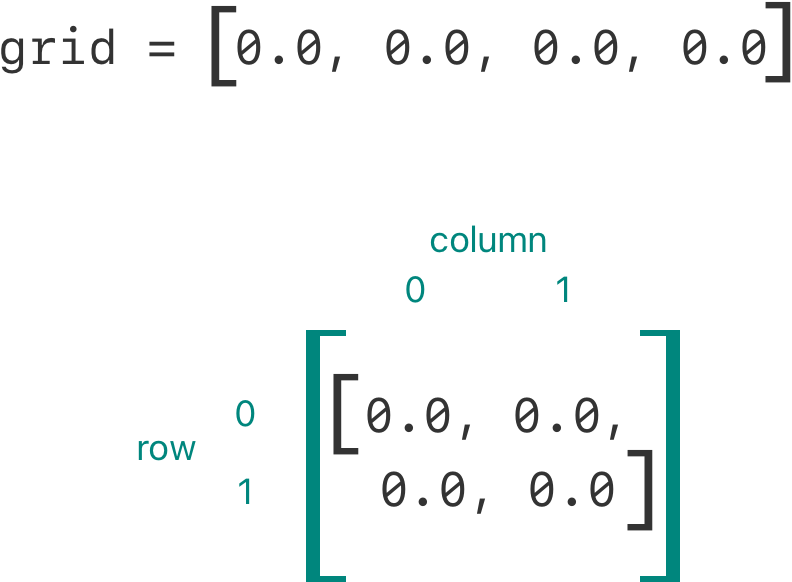

# 下标 {#Subscripts}

访问集合中的元素。

类、结构体和枚举都可以定义*下标*（subscript），它是访问集合、列表或序列中成员元素的快捷方式。你可以使用下标按索引设置和读取值，而无需分别提供用于设置和读取的方法。例如，你可以用 `someArray[index]` 访问 `Array` 实例中的元素，用 `someDictionary[key]` 访问 `Dictionary` 实例中的元素。

可以为同一个类型定义多个下标，具体使用哪个下标重载，由传入下标的索引值的类型决定。下标不限于一维，你还可以根据自定义类型的需要，定义带有多个输入参数的下标。

## 下标语法 {#Subscript-Syntax}

下标让你可以在实例名后的方括号中写入一个或多个值，以此查询该类型的实例。它的语法既类似于实例方法语法，也类似于计算属性语法。你使用 `subscript` 关键字编写下标定义，并像实例方法那样指定一个或多个输入参数和返回类型。与实例方法不同的是，下标可以是可读写的，也可以是只读的。这一点通过 getter 和 setter 来体现，方式与计算属性相同：

```swift
subscript(index: Int) -> Int {
    get {
        // Return an appropriate subscript value here.
    }
    set(newValue) {
        // Perform a suitable setting action here.
    }
}
```

`newValue` 的类型与下标的返回值类型相同。与计算属性一样，你也可以选择不指定 setter 的 `(newValue)` 参数。如果你不自行提供，setter 会获得一个名为 `newValue` 的默认参数。

与只读计算属性一样，你可以去掉 `get` 关键字及其花括号，从而简化只读下标的声明：

```swift
subscript(index: Int) -> Int {
    // Return an appropriate subscript value here.
}
```

下面是一个只读下标实现的例子，其中定义了一个 `TimesTable` 结构体，用来表示整数的 *n* 乘法表：

```swift
struct TimesTable {
    let multiplier: Int
    subscript(index: Int) -> Int {
        return multiplier * index
    }
}
let threeTimesTable = TimesTable(multiplier: 3)
print("six times three is \(threeTimesTable[6])")
// Prints "six times three is 18".
```

在这个例子中，创建了一个新的 `TimesTable` 实例来表示三的乘法表。这体现在向该结构体的 `initializer` 传入值 `3`，作为实例 `multiplier` 参数的值。

你可以调用 `threeTimesTable` 实例的下标来查询它，如 `threeTimesTable[6]` 所示。这会请求三的乘法表中的第六项，返回值为 `18`，即 `3` 乘以 `6`。

> 注意：*n* 乘法表基于固定的数学规则。把 `threeTimesTable[someIndex]` 设为新值并不合适，因此 `TimesTable` 的下标被定义为只读下标。

## 下标用法 {#Subscript-Usage}

“下标”的确切含义取决于其使用场景。下标通常用作访问集合、列表或序列中成员元素的快捷方式。你可以根据特定类或结构体的功能，以最合适的方式实现下标。

例如，Swift 的 `Dictionary` 类型实现了一个下标，用于设置和读取存储在 `Dictionary` 实例中的值。你可以在下标的方括号中提供字典键类型的键，并把字典值类型的值赋给该下标，从而在字典中设置值：

```swift
var numberOfLegs = ["spider": 8, "ant": 6, "cat": 4]
numberOfLegs["bird"] = 2
```

上面的例子定义了一个名为 `numberOfLegs` 的变量，并用包含三个键值对的字典字面量初始化它。`numberOfLegs` 字典的类型被推断为 `[String: Int]`。创建该字典后，这个例子使用下标赋值，向字典中添加一个值为 `"bird"` 的 `String` 键和一个值为 `2` 的 `Int` 值。

关于 `Dictionary` 下标的更多信息，请参阅 [访问和修改字典](collection-types.md#Accessing-and-Modifying-a-Dictionary)。

> 注意：Swift 的 `Dictionary` 类型把它的键值下标实现为接受并返回*可选类型*的下标。对于上面的 `numberOfLegs` 字典，其键值下标接受并返回 `Int?` 类型的值，即“可选整数”。`Dictionary` 类型使用可选的下标类型，以体现并非每个键都有值这一事实，并提供一种通过为某个键赋 `nil` 值来删除该键对应值的方式。

## 下标选项 {#Subscript-Options}

下标可以接受任意数量的输入参数，这些输入参数可以是任意类型。下标也可以返回任意类型的值。

与函数一样，下标可以接受数量可变的参数，并为参数提供默认值，详见 [可变参数](functions.md#Variadic-Parameters) 和 [默认形参值](functions.md#Default-Parameter-Values)。不过，与函数不同的是，下标不能使用输入输出参数。

类或结构体可以按需提供任意多个下标实现；在使用下标时，会根据方括号内包含的一个或多个值的类型，推断出应使用哪个下标。这种定义多个下标的方式称为*下标重载*（subscript overloading）。

虽然下标最常见的形式是接受单个参数，但如果适合你的类型，你也可以定义带多个参数的下标。下面的例子定义了一个 `Matrix` 结构体，表示由 `Double` 值组成的二维矩阵。`Matrix` 结构体的下标接受两个整数参数：

```swift
struct Matrix {
    let rows: Int, columns: Int
    var grid: [Double]
    init(rows: Int, columns: Int) {
        self.rows = rows
        self.columns = columns
        grid = Array(repeating: 0.0, count: rows * columns)
    }
    func indexIsValid(row: Int, column: Int) -> Bool {
        return row >= 0 && row < rows && column >= 0 && column < columns
    }
    subscript(row: Int, column: Int) -> Double {
        get {
            assert(indexIsValid(row: row, column: column), "Index out of range")
            return grid[(row * columns) + column]
        }
        set {
            assert(indexIsValid(row: row, column: column), "Index out of range")
            grid[(row * columns) + column] = newValue
        }
    }
}
```

`Matrix` 提供了一个构造器，接受名为 `rows` 和 `columns` 的两个参数，并创建一个足以存储 `rows * columns` 个 `Double` 值的数组。矩阵中的每个位置都被赋予初始值 `0.0`。为此，数组的大小和初始单元格值 `0.0` 会被传给一个数组构造器，由它创建并初始化一个大小正确的新数组。这个构造器在 [使用默认值创建数组](collection-types.md#Creating-an-Array-with-a-Default-Value) 中有更详细的介绍。

你可以向 `Matrix` 的构造器传入适当的行数和列数，来构造一个新的 `Matrix` 实例：

```swift
var matrix = Matrix(rows: 2, columns: 2)
```

上面的例子创建了一个两行两列的新 `Matrix` 实例。这个 `Matrix` 实例的 `grid` 数组实际上就是该矩阵按从左上到右下顺序展平后的版本：



可以通过向该下标传入用逗号分隔的行值和列值，来设置矩阵中的值：

```swift
matrix[0, 1] = 1.5
matrix[1, 0] = 3.2
```

这两条语句调用下标的 setter，把矩阵右上角位置（`row` 为 `0`、`column` 为 `1`）的值设为 `1.5`，把左下角位置（`row` 为 `1`、`column` 为 `0`）的值设为 `3.2`：



`Matrix` 下标的 getter 和 setter 都包含一个断言，用于检查下标的 `row` 和 `column` 值是否有效。为了配合这些断言，`Matrix` 包含一个名为 `indexIsValid(row:column:)` 的便利方法，用于检查请求的 `row` 和 `column` 是否在矩阵边界之内：

```swift
func indexIsValid(row: Int, column: Int) -> Bool {
    return row >= 0 && row < rows && column >= 0 && column < columns
}
```

如果你尝试访问矩阵边界之外的下标，就会触发断言：

```swift
let someValue = matrix[2, 2]
// This triggers an assert, because [2, 2] is outside of the matrix bounds.
```

## 类型下标 {#Type-Subscripts}

如上所述，实例下标是在特定类型的实例上调用的下标。你还可以定义在类型本身上调用的下标。这种下标称为*类型下标*（type subscript）。在 `subscript` 关键字之前写 `static` 关键字，即可表明这是类型下标。类可以改用 `class` 关键字，以允许子类重写父类对该下标的实现。下面的例子展示了如何定义和调用类型下标：

```swift
enum Planet: Int {
    case mercury = 1, venus, earth, mars, jupiter, saturn, uranus, neptune
    static subscript(n: Int) -> Planet {
        return Planet(rawValue: n)!
    }
}
let mars = Planet[4]
print(mars)
```
